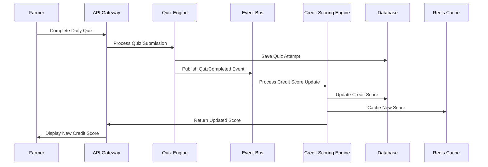

# Design Document: FinTech-AgTech Credit Scoring System

## Overview

The FinTech-AgTech Credit Scoring System transforms the Micro Fams platform from a marketplace into a comprehensive FinTech-enabled Agricultural Ecosystem focused on collective project financing. This design creates a behavioral-based credit scoring system that qualifies farmer groups for grants and collective project loans based on agricultural engagement, learning progress, and community participation. The system addresses the $2.3 trillion global agricultural credit gap by using behavioral data for credit underwriting instead of traditional collateral-based lending, targeting group-based collective ventures with profit sharing after loan repayment.

### Key Enhancement Areas

- **Collective Project Loan Architecture**: Exclusive focus on group collective projects (equipment, space booking, inputs, services) with profit sharing after repayment
- **One-Time Membership System**: Single payment platform membership with admin-configurable pricing instead of recurring subscriptions
- **Group Advancement Badge System**: Achievement tracking with Regional Coordinator verification for on-time repayment, project profitability, member retention, and leadership excellence
- **Location-Based Currency System**: Automatic currency selection (NGN for Nigeria, USD for international) based on group location
- **Administrative Pricing Interface**: Flexible pricing control with mandatory advance notification system for transparency
- **Revenue Sharing Architecture**: Industry-standard fee structures (60-70% loan origination, 80-90% grant administration, 20-25% course commissions)
- **Regional Coordinator System**: Internal role management for KYC verification and regional oversight
- **Group Profit Sharing Engine**: Flexible profit distribution rules within platform constraints (10% minimum, 40% maximum per member)

### Design Principles

1. **Collective Project Focus**: All loans exclusively for group collective projects with profit sharing after repayment
2. **One-Time Payment Model**: Single membership payments with admin-configurable pricing instead of recurring subscriptions
3. **Regional Coordination**: Internal Regional Coordinator system for verification and oversight
4. **Location-Based Operations**: Automatic currency selection and location-appropriate pricing
5. **Industry-Standard Revenue**: Competitive fee structures aligned with industry standards
6. **Group Advancement**: Badge system tracking group performance and reliability
7. **Administrative Flexibility**: Real-time pricing control with mandatory advance user notification
8. **Non-Breaking Integration**: All enhancements maintain compatibility with existing Micro Fams systems

## System Architecture

### High-Level Architecture Overview

```mermaid
graph TB
    subgraph "Frontend Layer"
        WEB[Web Dashboard<br/>React 18 + TypeScript]
        MOBILE[Mobile App<br/>React Native + Expo]
        PARTNER[Partner Portal<br/>Lender/Grant Org Interface]
    end
    
    subgraph "API Gateway Layer"
        GATEWAY[API Gateway<br/>Rate Limiting + Auth + Routing]
        WEBHOOK[Webhook Handler<br/>External Events]
    end
    
    subgraph "Core Services Layer"
        CREDIT[Credit Scoring Engine<br/>Real-time Calculation]
        QUIZ[Daily Quiz Engine<br/>Content + Scoring]
        TASK[Task Engine<br/>Activity Management]
        GROUP[Enhanced Group Service<br/>Collective Project Focus]
        FINANCE[Collective Project Finance<br/>Loans + Profit Sharing]
        EXTERNAL[External Integration<br/>Courses + Certificates]
        BADGES[Badge System<br/>Group Advancement Tracking]
        COORDINATOR[Regional Coordinator<br/>Verification + Oversight]
        PRICING[Administrative Pricing<br/>Flexible Fee Management]
    end
    
    subgraph "Event Processing Layer"
        EVENTS[Event Bus<br/>Redis Streams]
        WORKERS[Background Workers<br/>Score Calculation]
        SCHEDULER[Task Scheduler<br/>Daily Quizzes + Reminders]
    end
    
    subgraph "Integration Layer"
        PAYSTACK[Paystack API<br/>Payments + Fees]
        PARTNERS[Partner APIs<br/>Lenders + Grant Orgs]
        COURSES[External Course APIs<br/>Coursera + FutureLearn]
        BREVO[Brevo Email API<br/>Notifications]
        CURRENCY[Currency Exchange API<br/>NGN/USD Rates]
    end
    
    subgraph "Data Layer"
        DB[(PostgreSQL Supabase<br/>Core + Credit Data)]
        CACHE[(Redis Cache<br/>Credit Scores + Sessions)]
        AUDIT[(Audit Store<br/>Credit Score Ledger)]
        FILES[File Storage<br/>Certificates + Documents]
    end
    
    WEB --> GATEWAY
    MOBILE --> GATEWAY
    PARTNER --> GATEWAY
    WEBHOOK --> GATEWAY
    
    GATEWAY --> CREDIT
    GATEWAY --> QUIZ
    GATEWAY --> TASK
    GATEWAY --> GROUP
    GATEWAY --> FINANCE
    GATEWAY --> EXTERNAL
    GATEWAY --> BADGES
    GATEWAY --> COORDINATOR
    GATEWAY --> PRICING
    
    CREDIT --> EVENTS
    QUIZ --> EVENTS
    TASK --> EVENTS
    GROUP --> EVENTS
    BADGES --> EVENTS
    
    EVENTS --> WORKERS
    WORKERS --> CREDIT
    SCHEDULER --> QUIZ
    
    FINANCE --> PAYSTACK
    FINANCE --> PARTNERS
    EXTERNAL --> COURSES
    CREDIT --> BREVO
    PRICING --> CURRENCY
    
    CREDIT --> DB
    CREDIT --> CACHE
    CREDIT --> AUDIT
    QUIZ --> DB
    TASK --> DB
    GROUP --> DB
    FINANCE --> DB
    BADGES --> DB
    COORDINATOR --> DB
    PRICING --> DB
    EXTERNAL --> FILES
```


### Event-Driven Credit Scoring Architecture

The system implements an event-driven architecture to ensure real-time credit score updates while maintaining system performance:



### Service Architecture Patterns

#### Credit Scoring Engine
- **Pattern**: Event Sourcing + CQRS
- **Responsibility**: Real-time credit score calculation and validation
- **Scalability**: Horizontal scaling with event partitioning by user_id
- **Performance**: Sub-100ms score updates with Redis caching

#### Quiz Engine
- **Pattern**: Domain-Driven Design with Anti-Corruption Layer
- **Responsibility**: Daily quiz generation, scoring, and anti-gaming validation
- **Integration**: Time-tracking and behavioral analysis for fraud prevention
- **Content**: Dynamic difficulty adjustment based on farmer performance

#### Task Engine
- **Pattern**: Strategy Pattern for different task types
- **Responsibility**: Video, social, photo, and group task management
- **Validation**: GPS verification, time-on-page tracking, peer review
- **Gamification**: Progressive difficulty and reward systems

#### Financial Service
- **Pattern**: Saga Pattern for distributed transactions
- **Responsibility**: Loan processing, grant distribution, partner integration
- **Compliance**: Built-in KYC/AML validation and regulatory reporting
- **Risk Management**: ML-based risk assessment and fraud detection

## Database Schema Design

### Core Credit Scoring Tables

```sql
-- Enhanced user table with credit scoring fields
ALTER TABLE users ADD COLUMN IF NOT EXISTS membership_tier VARCHAR(20) DEFAULT 'basic';
ALTER TABLE users ADD COLUMN IF NOT EXISTS membership_expires_at TIMESTAMP WITH TIME ZONE;
ALTER TABLE users ADD COLUMN IF NOT EXISTS kyc_status VARCHAR(20) DEFAULT 'pending';
ALTER TABLE users ADD COLUMN IF NOT EXISTS kyc_verified_at TIMESTAMP WITH TIME ZONE;

-- Credit scores table (main scoring record)
CREATE TABLE IF NOT EXISTS credit_scores (
    id UUID PRIMARY KEY DEFAULT gen_random_uuid(),
    user_id UUID REFERENCES users(id) ON DELETE CASCADE UNIQUE,
    total_score INTEGER NOT NULL DEFAULT 0 CHECK (total_score >= 0 AND total_score <= 1000),
    membership_score INTEGER NOT NULL DEFAULT 0 CHECK (membership_score >= 0 AND membership_score <= 1000),
    learning_score INTEGER NOT NULL DEFAULT 0 CHECK (learning_score >= 0 AND learning_score <= 1000),
    leadership_score INTEGER NOT NULL DEFAULT 0 CHECK (leadership_score >= 0 AND leadership_score <= 1000),
    engagement_score INTEGER NOT NULL DEFAULT 0 CHECK (engagement_score >= 0 AND engagement_score <= 1000),
    social_score INTEGER NOT NULL DEFAULT 0 CHECK (social_score >= 0 AND social_score <= 1000),
    reliability_score INTEGER NOT NULL DEFAULT 0 CHECK (reliability_score >= 0 AND reliability_score <= 1000),
    tier VARCHAR(20) GENERATED ALWAYS AS (
        CASE 
            WHEN total_score >= 800 THEN 'platinum'
            WHEN total_score >= 600 THEN 'gold'
            WHEN total_score >= 300 THEN 'silver'
            ELSE 'bronze'
        END
    ) STORED,
    last_calculated TIMESTAMP WITH TIME ZONE DEFAULT NOW(),
    calculation_version INTEGER DEFAULT 1,
    created_at TIMESTAMP WITH TIME ZONE DEFAULT NOW(),
    updated_at TIMESTAMP WITH TIME ZONE DEFAULT NOW()
);

-- Credit score ledger (immutable audit trail)
CREATE TABLE IF NOT EXISTS credit_score_ledger (
    id UUID PRIMARY KEY DEFAULT gen_random_uuid(),
    user_id UUID REFERENCES users(id) ON DELETE CASCADE,
    activity_type VARCHAR(50) NOT NULL,
    activity_id UUID, -- Reference to specific activity (quiz_id, task_id, etc.)
    points_change INTEGER NOT NULL,
    score_component VARCHAR(20) NOT NULL CHECK (score_component IN ('membership', 'learning', 'leadership', 'engagement', 'social', 'reliability')),
    previous_score INTEGER NOT NULL,
    new_score INTEGER NOT NULL,
    activity_data JSONB,
    created_at TIMESTAMP WITH TIME ZONE DEFAULT NOW()
);

-- Credit score activities (detailed activity tracking)
CREATE TABLE IF NOT EXISTS credit_activities (
    id UUID PRIMARY KEY DEFAULT gen_random_uuid(),
    user_id UUID REFERENCES users(id) ON DELETE CASCADE,
    activity_type VARCHAR(50) NOT NULL,
    activity_category VARCHAR(30) NOT NULL,
    points_earned INTEGER NOT NULL DEFAULT 0,
    metadata JSONB,
    validation_status VARCHAR(20) DEFAULT 'pending' CHECK (validation_status IN ('pending', 'validated', 'rejected', 'flagged')),
    validation_reason TEXT,
    created_at TIMESTAMP WITH TIME ZONE DEFAULT NOW()
);
```
### Quiz System Tables

```sql
-- Quiz categories for content organization
CREATE TABLE IF NOT EXISTS quiz_categories (
    id UUID PRIMARY KEY DEFAULT gen_random_uuid(),
    name VARCHAR(100) NOT NULL UNIQUE,
    description TEXT,
    agricultural_focus VARCHAR(50) CHECK (agricultural_focus IN ('poultry', 'crops', 'livestock', 'fishery', 'general')),
    difficulty_level INTEGER CHECK (difficulty_level BETWEEN 1 AND 5),
    is_active BOOLEAN DEFAULT true,
    created_at TIMESTAMP WITH TIME ZONE DEFAULT NOW()
);

-- Daily quizzes with questions and scoring
CREATE TABLE IF NOT EXISTS daily_quizzes (
    id UUID PRIMARY KEY DEFAULT gen_random_uuid(),
    category_id UUID REFERENCES quiz_categories(id),
    title VARCHAR(255) NOT NULL,
    description TEXT,
    questions JSONB NOT NULL, -- Array of question objects with answers
    max_score INTEGER NOT NULL,
    difficulty_level INTEGER CHECK (difficulty_level BETWEEN 1 AND 5),
    active_date DATE NOT NULL,
    expires_at TIMESTAMP WITH TIME ZONE,
    min_time_seconds INTEGER DEFAULT 60, -- Anti-gaming: minimum time to complete
    created_by UUID REFERENCES users(id),
    is_active BOOLEAN DEFAULT true,
    created_at TIMESTAMP WITH TIME ZONE DEFAULT NOW()
);

-- User quiz attempts with anti-gaming tracking
CREATE TABLE IF NOT EXISTS user_quiz_attempts (
    id UUID PRIMARY KEY DEFAULT gen_random_uuid(),
    user_id UUID REFERENCES users(id) ON DELETE CASCADE,
    quiz_id UUID REFERENCES daily_quizzes(id) ON DELETE CASCADE,
    score INTEGER NOT NULL,
    max_possible_score INTEGER NOT NULL,
    percentage DECIMAL(5,2) GENERATED ALWAYS AS (ROUND((score::DECIMAL / max_possible_score) * 100, 2)) STORED,
    answers JSONB NOT NULL, -- User's answers for review
    time_taken_seconds INTEGER NOT NULL,
    start_time TIMESTAMP WITH TIME ZONE NOT NULL,
    completion_time TIMESTAMP WITH TIME ZONE DEFAULT NOW(),
    ip_address INET,
    user_agent TEXT,
    is_flagged BOOLEAN DEFAULT false,
    flagged_reason TEXT,
    points_awarded INTEGER DEFAULT 0,
    UNIQUE(user_id, quiz_id) -- One attempt per quiz per user
);

-- Quiz performance streaks
CREATE TABLE IF NOT EXISTS quiz_streaks (
    id UUID PRIMARY KEY DEFAULT gen_random_uuid(),
    user_id UUID REFERENCES users(id) ON DELETE CASCADE UNIQUE,
    current_streak INTEGER DEFAULT 0,
    longest_streak INTEGER DEFAULT 0,
    last_quiz_date DATE,
    streak_start_date DATE,
    total_quizzes_completed INTEGER DEFAULT 0,
    average_score DECIMAL(5,2) DEFAULT 0,
    updated_at TIMESTAMP WITH TIME ZONE DEFAULT NOW()
);
```

### Task Engine Tables

```sql
-- Task types and categories
CREATE TABLE IF NOT EXISTS task_types (
    id UUID PRIMARY KEY DEFAULT gen_random_uuid(),
    name VARCHAR(50) NOT NULL UNIQUE,
    description TEXT,
    category VARCHAR(30) NOT NULL CHECK (category IN ('video', 'social', 'photo', 'quiz', 'group', 'learning')),
    base_points INTEGER DEFAULT 10,
    validation_required BOOLEAN DEFAULT false,
    min_time_seconds INTEGER DEFAULT 0,
    created_at TIMESTAMP WITH TIME ZONE DEFAULT NOW()
);

-- Individual tasks
CREATE TABLE IF NOT EXISTS tasks (
    id UUID PRIMARY KEY DEFAULT gen_random_uuid(),
    task_type_id UUID REFERENCES task_types(id),
    title VARCHAR(255) NOT NULL,
    description TEXT,
    instructions JSONB, -- Task-specific instructions and requirements
    points_value INTEGER NOT NULL DEFAULT 10,
    difficulty_level INTEGER CHECK (difficulty_level BETWEEN 1 AND 5),
    is_group_task BOOLEAN DEFAULT false,
    min_participants INTEGER DEFAULT 1,
    max_participants INTEGER,
    expires_at TIMESTAMP WITH TIME ZONE,
    is_active BOOLEAN DEFAULT true,
    created_by UUID REFERENCES users(id),
    created_at TIMESTAMP WITH TIME ZONE DEFAULT NOW()
);

-- Task completions with validation
CREATE TABLE IF NOT EXISTS task_completions (
    id UUID PRIMARY KEY DEFAULT gen_random_uuid(),
    user_id UUID REFERENCES users(id) ON DELETE CASCADE,
    task_id UUID REFERENCES tasks(id) ON DELETE CASCADE,
    group_id UUID REFERENCES groups(id) ON DELETE SET NULL,
    completion_data JSONB NOT NULL, -- Evidence of completion (photos, links, etc.)
    time_spent_seconds INTEGER,
    validation_status VARCHAR(20) DEFAULT 'pending' CHECK (validation_status IN ('pending', 'approved', 'rejected', 'flagged')),
    validator_id UUID REFERENCES users(id),
    validation_notes TEXT,
    points_earned INTEGER DEFAULT 0,
    completed_at TIMESTAMP WITH TIME ZONE DEFAULT NOW(),
    validated_at TIMESTAMP WITH TIME ZONE,
    UNIQUE(user_id, task_id) -- One completion per task per user
);
```
### Enhanced Group System Tables for Collective Projects

```sql
-- One-time membership system (updated from subscription model)
CREATE TABLE IF NOT EXISTS platform_memberships (
    id UUID PRIMARY KEY DEFAULT gen_random_uuid(),
    user_id UUID REFERENCES users(id) ON DELETE CASCADE UNIQUE,
    membership_fee DECIMAL(10,2) NOT NULL,
    currency VARCHAR(3) NOT NULL,
    payment_reference VARCHAR(255) NOT NULL,
    payment_date TIMESTAMP WITH TIME ZONE DEFAULT NOW(),
    status VARCHAR(20) CHECK (status IN ('active', 'suspended', 'revoked')) DEFAULT 'active',
    created_at TIMESTAMP WITH TIME ZONE DEFAULT NOW()
);

-- Enhanced groups table for collective project focus
ALTER TABLE groups ADD COLUMN IF NOT EXISTS entry_fee DECIMAL(10,2) DEFAULT 0;
ALTER TABLE groups ADD COLUMN IF NOT EXISTS entry_fee_currency VARCHAR(3) DEFAULT 'NGN';
ALTER TABLE groups ADD COLUMN IF NOT EXISTS max_members INTEGER DEFAULT 10;
ALTER TABLE groups ADD COLUMN IF NOT EXISTS min_members INTEGER DEFAULT 5;
ALTER TABLE groups ADD COLUMN IF NOT EXISTS group_status VARCHAR(30) DEFAULT 'pending_payment' 
    CHECK (group_status IN ('pending_payment', 'pending_members', 'active', 'inactive', 'suspended'));
ALTER TABLE groups ADD COLUMN IF NOT EXISTS project_focus TEXT;
ALTER TABLE groups ADD COLUMN IF NOT EXISTS location VARCHAR(100);
ALTER TABLE groups ADD COLUMN IF NOT EXISTS country VARCHAR(50);
ALTER TABLE groups ADD COLUMN IF NOT EXISTS collective_project_only BOOLEAN DEFAULT true;

-- Collective project loans (replaces individual lending)
CREATE TABLE IF NOT EXISTS collective_project_loans (
    id UUID PRIMARY KEY DEFAULT gen_random_uuid(),
    group_id UUID REFERENCES groups(id) ON DELETE CASCADE,
    project_title VARCHAR(255) NOT NULL,
    project_description TEXT NOT NULL,
    project_type VARCHAR(50) CHECK (project_type IN ('equipment', 'space_booking', 'inputs', 'services', 'mixed')),
    loan_amount DECIMAL(12,2) NOT NULL,
    currency VARCHAR(3) NOT NULL,
    interest_rate DECIMAL(5,2) DEFAULT 0,
    loan_term_months INTEGER NOT NULL,
    profit_sharing_agreement JSONB NOT NULL,
    unanimous_consent_achieved BOOLEAN DEFAULT false,
    consent_records JSONB, -- Record of each member's consent
    project_start_date DATE,
    expected_completion_date DATE,
    actual_completion_date DATE,
    project_profitability DECIMAL(12,2) DEFAULT 0,
    profit_distribution_status VARCHAR(30) DEFAULT 'restricted' 
        CHECK (profit_distribution_status IN ('restricted', 'available', 'distributed')),
    loan_status VARCHAR(30) DEFAULT 'draft' 
        CHECK (loan_status IN ('draft', 'pending_approval', 'approved', 'disbursed', 'active', 'completed', 'defaulted')),
    regional_coordinator_verified BOOLEAN DEFAULT false,
    verified_by UUID REFERENCES users(id),
    verification_date TIMESTAMP WITH TIME ZONE,
    created_at TIMESTAMP WITH TIME ZONE DEFAULT NOW(),
    updated_at TIMESTAMP WITH TIME ZONE DEFAULT NOW()
);

-- Group profit sharing rules
CREATE TABLE IF NOT EXISTS group_profit_sharing_rules (
    id UUID PRIMARY KEY DEFAULT gen_random_uuid(),
    group_id UUID REFERENCES groups(id) ON DELETE CASCADE UNIQUE,
    sharing_type VARCHAR(20) CHECK (sharing_type IN ('equal', 'contribution_based', 'custom')),
    rules JSONB NOT NULL, -- Detailed sharing rules and percentages
    min_member_share DECIMAL(5,2) DEFAULT 10.00, -- Platform minimum 10%
    max_member_share DECIMAL(5,2) DEFAULT 40.00, -- Platform maximum 40%
    requires_unanimous_consent BOOLEAN DEFAULT true,
    approved_by_group BOOLEAN DEFAULT false,
    created_at TIMESTAMP WITH TIME ZONE DEFAULT NOW(),
    updated_at TIMESTAMP WITH TIME ZONE DEFAULT NOW()
);

-- Group advancement badges and achievements
CREATE TABLE IF NOT EXISTS group_advancement_badges (
    id UUID PRIMARY KEY DEFAULT gen_random_uuid(),
    group_id UUID REFERENCES groups(id) ON DELETE CASCADE,
    badge_type VARCHAR(30) CHECK (badge_type IN ('on_time_repayment', 'project_profitability', 'member_retention', 'leadership_excellence')),
    earned_date TIMESTAMP WITH TIME ZONE DEFAULT NOW(),
    verification_data JSONB, -- Evidence of achievement
    verified_by UUID REFERENCES users(id), -- Regional coordinator who verified
    badge_level INTEGER DEFAULT 1, -- Bronze (1), Silver (2), Gold (3)
    expiry_date TIMESTAMP WITH TIME ZONE,
    is_active BOOLEAN DEFAULT true,
    loan_id UUID REFERENCES collective_project_loans(id) -- Associated loan for context
);

-- Regional coordinator management
CREATE TABLE IF NOT EXISTS regional_coordinators (
    id UUID PRIMARY KEY DEFAULT gen_random_uuid(),
    user_id UUID REFERENCES users(id) ON DELETE CASCADE,
    region VARCHAR(100) NOT NULL,
    country VARCHAR(50) NOT NULL,
    responsibilities JSONB NOT NULL,
    groups_managed UUID[] DEFAULT '{}',
    performance_metrics JSONB,
    appointed_date TIMESTAMP WITH TIME ZONE DEFAULT NOW(),
    is_active BOOLEAN DEFAULT true
);

-- Location and currency management
CREATE TABLE IF NOT EXISTS location_currency_settings (
    id UUID PRIMARY KEY DEFAULT gen_random_uuid(),
    country VARCHAR(50) NOT NULL UNIQUE,
    currency_code VARCHAR(3) NOT NULL,
    is_local BOOLEAN DEFAULT false, -- Nigeria = true (local), others = false (international)
    exchange_rate DECIMAL(10,4) DEFAULT 1.0000,
    membership_fee DECIMAL(10,2),
    group_entry_fee_min DECIMAL(10,2),
    group_entry_fee_max DECIMAL(10,2),
    last_updated TIMESTAMP WITH TIME ZONE DEFAULT NOW()
);

-- Administrative pricing interface
CREATE TABLE IF NOT EXISTS administrative_pricing (
    id UUID PRIMARY KEY DEFAULT gen_random_uuid(),
    pricing_type VARCHAR(50) CHECK (pricing_type IN ('platform_membership', 'group_entry_tier_1', 'group_entry_tier_2', 'group_entry_tier_3')),
    currency VARCHAR(3) NOT NULL,
    current_price DECIMAL(10,2) NOT NULL,
    pending_price DECIMAL(10,2),
    price_change_date TIMESTAMP WITH TIME ZONE,
    notification_sent_date TIMESTAMP WITH TIME ZONE,
    advance_notice_days INTEGER DEFAULT 30,
    change_reason TEXT,
    created_by UUID REFERENCES users(id),
    created_at TIMESTAMP WITH TIME ZONE DEFAULT NOW(),
    updated_at TIMESTAMP WITH TIME ZONE DEFAULT NOW()
);

-- Group performance metrics for collective projects
CREATE TABLE IF NOT EXISTS group_performance (
    id UUID PRIMARY KEY DEFAULT gen_random_uuid(),
    group_id UUID REFERENCES groups(id) ON DELETE CASCADE UNIQUE,
    total_members INTEGER DEFAULT 0,
    active_members INTEGER DEFAULT 0,
    total_project_loans DECIMAL(12,2) DEFAULT 0,
    successful_projects INTEGER DEFAULT 0,
    project_success_rate DECIMAL(5,2) DEFAULT 0,
    total_profit_generated DECIMAL(12,2) DEFAULT 0,
    average_project_duration INTEGER DEFAULT 0, -- in days
    member_retention_rate DECIMAL(5,2) DEFAULT 0,
    group_advancement_accs INTEGER DEFAULT 0,
    last_project_date TIMESTAMP WITH TIME ZONE,
    updated_at TIMESTAMP WITH TIME ZONE DEFAULT NOW()
);

-- Single group membership policy enforcement
CREATE TABLE IF NOT EXISTS user_group_memberships (
    id UUID PRIMARY KEY DEFAULT gen_random_uuid(),
    user_id UUID REFERENCES users(id) ON DELETE CASCADE,
    group_id UUID REFERENCES groups(id) ON DELETE CASCADE,
    membership_status VARCHAR(20) DEFAULT 'active' CHECK (membership_status IN ('active', 'inactive', 'suspended')),
    joined_date TIMESTAMP WITH TIME ZONE DEFAULT NOW(),
    left_date TIMESTAMP WITH TIME ZONE,
    UNIQUE(user_id, group_id),
    -- Constraint to enforce single group membership
    EXCLUDE (user_id WITH =) WHERE (membership_status = 'active')
);
```

### Financial System Tables for Collective Projects

```sql
-- Lending partner organizations
CREATE TABLE IF NOT EXISTS lending_partners (
    id UUID PRIMARY KEY DEFAULT gen_random_uuid(),
    organization_name VARCHAR(255) NOT NULL,
    partner_type VARCHAR(50) CHECK (partner_type IN ('microfinance', 'development_bank', 'government', 'ngo', 'private_lender')),
    contact_info JSONB,
    api_credentials JSONB, -- Encrypted API keys and endpoints
    minimum_credit_score INTEGER NOT NULL,
    maximum_loan_amount DECIMAL(12,2),
    interest_rate_range JSONB, -- Min/max interest rates
    loan_terms JSONB, -- Available loan terms and conditions
    requirements JSONB, -- Additional lending requirements
    collective_project_focus BOOLEAN DEFAULT true, -- Only collective project loans
    revenue_sharing_rate DECIMAL(5,2) DEFAULT 35.00, -- Partner share (30-40%)
    is_active BOOLEAN DEFAULT true,
    created_at TIMESTAMP WITH TIME ZONE DEFAULT NOW()
);

-- Financial qualifications tracking for groups
CREATE TABLE IF NOT EXISTS group_financial_qualifications (
    id UUID PRIMARY KEY DEFAULT gen_random_uuid(),
    group_id UUID REFERENCES groups(id) ON DELETE CASCADE,
    qualification_type VARCHAR(50) CHECK (qualification_type IN ('micro_grant', 'partner_grant', 'collective_micro_lending', 'interest_free_collective_lending')),
    credit_score_required INTEGER NOT NULL,
    current_group_credit_score INTEGER NOT NULL,
    qualified BOOLEAN GENERATED ALWAYS AS (current_group_credit_score >= credit_score_required) STORED,
    qualification_date TIMESTAMP WITH TIME ZONE,
    partner_id UUID REFERENCES lending_partners(id),
    amount_qualified_for DECIMAL(12,2),
    terms JSONB, -- Specific terms for this qualification
    status VARCHAR(30) CHECK (status IN ('qualified', 'applied', 'approved', 'disbursed', 'completed', 'defaulted')) DEFAULT 'qualified',
    expires_at TIMESTAMP WITH TIME ZONE,
    created_at TIMESTAMP WITH TIME ZONE DEFAULT NOW()
);

-- Collective project loan applications and processing
CREATE TABLE IF NOT EXISTS collective_loan_applications (
    id UUID PRIMARY KEY DEFAULT gen_random_uuid(),
    group_id UUID REFERENCES groups(id) ON DELETE CASCADE,
    collective_project_loan_id UUID REFERENCES collective_project_loans(id),
    partner_id UUID REFERENCES lending_partners(id),
    application_reference VARCHAR(100) UNIQUE,
    requested_amount DECIMAL(12,2) NOT NULL,
    approved_amount DECIMAL(12,2),
    interest_rate DECIMAL(5,2),
    loan_term_months INTEGER,
    project_purpose TEXT,
    group_credit_score_at_application INTEGER NOT NULL,
    risk_assessment JSONB, -- ML-based risk scoring
    supporting_documents JSONB, -- Document URLs and metadata
    unanimous_consent_verified BOOLEAN DEFAULT false,
    profit_sharing_agreement JSONB NOT NULL,
    status VARCHAR(30) CHECK (status IN ('draft', 'submitted', 'under_review', 'approved', 'rejected', 'disbursed', 'active', 'completed', 'defaulted')),
    application_date TIMESTAMP WITH TIME ZONE DEFAULT NOW(),
    decision_date TIMESTAMP WITH TIME ZONE,
    disbursement_date TIMESTAMP WITH TIME ZONE,
    created_at TIMESTAMP WITH TIME ZONE DEFAULT NOW()
);

-- Grant distributions for collective projects
CREATE TABLE IF NOT EXISTS collective_grant_distributions (
    id UUID PRIMARY KEY DEFAULT gen_random_uuid(),
    group_id UUID REFERENCES groups(id) ON DELETE CASCADE,
    grant_type VARCHAR(50) NOT NULL,
    amount DECIMAL(10,2) NOT NULL,
    currency VARCHAR(3) NOT NULL,
    source_organization VARCHAR(255),
    collective_project_purpose TEXT,
    group_credit_score_at_award INTEGER NOT NULL,
    distribution_method VARCHAR(50) DEFAULT 'automatic',
    status VARCHAR(30) CHECK (status IN ('approved', 'disbursed', 'completed', 'cancelled')),
    disbursement_reference VARCHAR(255),
    awarded_at TIMESTAMP WITH TIME ZONE DEFAULT NOW(),
    disbursed_at TIMESTAMP WITH TIME ZONE,
    completion_report JSONB, -- Impact reporting
    created_at TIMESTAMP WITH TIME ZONE DEFAULT NOW()
);

-- Revenue sharing tracking with industry standards
CREATE TABLE IF NOT EXISTS revenue_sharing_transactions (
    id UUID PRIMARY KEY DEFAULT gen_random_uuid(),
    transaction_type VARCHAR(50) CHECK (transaction_type IN ('loan_origination', 'grant_administration', 'course_commission')),
    source_transaction_id UUID, -- Reference to loan, grant, or course completion
    partner_id UUID REFERENCES lending_partners(id),
    total_fee DECIMAL(12,2) NOT NULL,
    platform_share DECIMAL(12,2) NOT NULL,
    partner_share DECIMAL(12,2) NOT NULL,
    platform_retention_rate DECIMAL(5,2) NOT NULL, -- 60-70% for loans, 80-90% for grants, 20-25% for courses
    partner_share_rate DECIMAL(5,2) NOT NULL,
    currency VARCHAR(3) NOT NULL,
    fee_calculation_data JSONB, -- Detailed calculation breakdown
    settlement_status VARCHAR(30) DEFAULT 'pending' CHECK (settlement_status IN ('pending', 'processed', 'completed', 'disputed')),
    settlement_date TIMESTAMP WITH TIME ZONE,
    created_at TIMESTAMP WITH TIME ZONE DEFAULT NOW()
);

-- Loan repayment tracking for collective projects
CREATE TABLE IF NOT EXISTS collective_loan_repayments (
    id UUID PRIMARY KEY DEFAULT gen_random_uuid(),
    collective_loan_id UUID REFERENCES collective_project_loans(id) ON DELETE CASCADE,
    repayment_amount DECIMAL(12,2) NOT NULL,
    currency VARCHAR(3) NOT NULL,
    repayment_date TIMESTAMP WITH TIME ZONE DEFAULT NOW(),
    due_date TIMESTAMP WITH TIME ZONE NOT NULL,
    is_on_time BOOLEAN GENERATED ALWAYS AS (repayment_date <= due_date) STORED,
    early_payment_days INTEGER GENERATED ALWAYS AS (
        CASE WHEN repayment_date < due_date 
        THEN EXTRACT(days FROM due_date - repayment_date)::INTEGER 
        ELSE 0 END
    ) STORED,
    group_accs_points_awarded INTEGER DEFAULT 0,
    badge_eligibility_updated BOOLEAN DEFAULT false,
    payment_reference VARCHAR(255),
    created_at TIMESTAMP WITH TIME ZONE DEFAULT NOW()
);

-- Profit distribution tracking
CREATE TABLE IF NOT EXISTS collective_profit_distributions (
    id UUID PRIMARY KEY DEFAULT gen_random_uuid(),
    collective_loan_id UUID REFERENCES collective_project_loans(id) ON DELETE CASCADE,
    group_id UUID REFERENCES groups(id) ON DELETE CASCADE,
    total_profit DECIMAL(12,2) NOT NULL,
    distribution_date TIMESTAMP WITH TIME ZONE DEFAULT NOW(),
    distribution_rules JSONB NOT NULL, -- Applied profit sharing rules
    member_distributions JSONB NOT NULL, -- Individual member profit shares
    loan_fully_repaid BOOLEAN NOT NULL,
    regional_coordinator_verified BOOLEAN DEFAULT false,
    verified_by UUID REFERENCES users(id),
    verification_date TIMESTAMP WITH TIME ZONE,
    created_at TIMESTAMP WITH TIME ZONE DEFAULT NOW()
);
```
### External Course Integration Tables

```sql
-- External course platforms
CREATE TABLE IF NOT EXISTS external_platforms (
    id UUID PRIMARY KEY DEFAULT gen_random_uuid(),
    platform_name VARCHAR(100) NOT NULL UNIQUE,
    platform_type VARCHAR(50) CHECK (platform_type IN ('mooc', 'certification', 'university', 'corporate')),
    api_endpoint TEXT,
    api_credentials JSONB, -- Encrypted API keys
    webhook_secret VARCHAR(255),
    integration_status VARCHAR(20) DEFAULT 'active' CHECK (integration_status IN ('active', 'inactive', 'maintenance')),
    supported_features JSONB, -- Available API features
    created_at TIMESTAMP WITH TIME ZONE DEFAULT NOW()
);

-- External courses catalog
CREATE TABLE IF NOT EXISTS external_courses (
    id UUID PRIMARY KEY DEFAULT gen_random_uuid(),
    platform_id UUID REFERENCES external_platforms(id),
    external_course_id VARCHAR(255) NOT NULL,
    title VARCHAR(255) NOT NULL,
    description TEXT,
    category VARCHAR(100),
    difficulty_level INTEGER CHECK (difficulty_level BETWEEN 1 AND 5),
    duration_hours INTEGER,
    price DECIMAL(10,2),
    currency VARCHAR(3) DEFAULT 'USD',
    language VARCHAR(10) DEFAULT 'en',
    instructor_name VARCHAR(255),
    rating DECIMAL(3,2),
    enrollment_url TEXT,
    is_active BOOLEAN DEFAULT true,
    last_synced TIMESTAMP WITH TIME ZONE DEFAULT NOW(),
    created_at TIMESTAMP WITH TIME ZONE DEFAULT NOW(),
    UNIQUE(platform_id, external_course_id)
);

-- User external course enrollments
CREATE TABLE IF NOT EXISTS external_course_enrollments (
    id UUID PRIMARY KEY DEFAULT gen_random_uuid(),
    user_id UUID REFERENCES users(id) ON DELETE CASCADE,
    external_course_id UUID REFERENCES external_courses(id),
    enrollment_reference VARCHAR(255),
    enrollment_date TIMESTAMP WITH TIME ZONE DEFAULT NOW(),
    completion_date TIMESTAMP WITH TIME ZONE,
    progress_percentage INTEGER DEFAULT 0 CHECK (progress_percentage >= 0 AND progress_percentage <= 100),
    final_score DECIMAL(5,2),
    certificate_url TEXT,
    certificate_verified BOOLEAN DEFAULT false,
    verification_date TIMESTAMP WITH TIME ZONE,
    points_awarded INTEGER DEFAULT 0,
    status VARCHAR(20) DEFAULT 'enrolled' CHECK (status IN ('enrolled', 'in_progress', 'completed', 'dropped', 'expired'))
);

-- Certificate verification system
CREATE TABLE IF NOT EXISTS certificate_verifications (
    id UUID PRIMARY KEY DEFAULT gen_random_uuid(),
    user_id UUID REFERENCES users(id) ON DELETE CASCADE,
    enrollment_id UUID REFERENCES external_course_enrollments(id),
    certificate_data JSONB, -- Certificate metadata and verification info
    verification_method VARCHAR(50) CHECK (verification_method IN ('api_automatic', 'manual_upload', 'blockchain', 'digital_signature')),
    verification_status VARCHAR(20) DEFAULT 'pending' CHECK (verification_status IN ('pending', 'verified', 'rejected', 'expired')),
    verifier_id UUID REFERENCES users(id), -- Admin who verified manually
    verification_notes TEXT,
    verified_at TIMESTAMP WITH TIME ZONE,
    expires_at TIMESTAMP WITH TIME ZONE,
    created_at TIMESTAMP WITH TIME ZONE DEFAULT NOW()
);
```

## Components and Interfaces

### Collective Project Loan System

The Collective Project Loan System is the core financial component that exclusively handles group-based lending for agricultural collective projects with profit sharing after repayment.

```typescript
interface CollectiveProjectLoan {
  id: string;
  group_id: string;
  project_title: string;
  project_description: string;
  project_type: 'equipment' | 'space_booking' | 'inputs' | 'services' | 'mixed';
  loan_amount: number;
  currency: 'NGN' | 'USD';
  interest_rate: number;
  loan_term_months: number;
  profit_sharing_agreement: ProfitSharingAgreement;
  unanimous_consent_achieved: boolean;
  consent_records: ConsentRecord[];
  project_start_date?: Date;
  expected_completion_date?: Date;
  actual_completion_date?: Date;
  project_profitability: number;
  profit_distribution_status: 'restricted' | 'available' | 'distributed';
  loan_status: LoanStatus;
  regional_coordinator_verified: boolean;
  verified_by?: string;
  verification_date?: Date;
}

interface ProfitSharingAgreement {
  sharing_type: 'equal' | 'contribution_based' | 'custom';
  member_shares: MemberShare[];
  platform_constraints: {
    min_member_share: 10; // 10% minimum
    max_member_share: 40; // 40% maximum
  };
  requires_unanimous_consent: true;
  approved_by_group: boolean;
}

interface MemberShare {
  user_id: string;
  share_percentage: number; // Must be between 10-40%
  contribution_basis?: string;
  role_in_project?: string;
}

class CollectiveProjectLoanService {
  async createLoan(groupId: string, loanData: CreateLoanRequest): Promise<CollectiveProjectLoan> {
    // Validate group eligibility for collective projects
    await this.validateGroupEligibility(groupId);
    
    // Ensure loan is for collective project only
    if (!this.isCollectiveProject(loanData.project_type)) {
      throw new Error('Loans are exclusively for group collective projects');
    }
    
    // Validate profit sharing agreement
    await this.validateProfitSharingAgreement(loanData.profit_sharing_agreement);
    
    // Create loan with restricted profit distribution
    const loan = await this.createCollectiveLoan({
      ...loanData,
      group_id: groupId,
      profit_distribution_status: 'restricted',
      unanimous_consent_achieved: false
    });
    
    return loan;
  }
  
  async requestUnanimousConsent(loanId: string): Promise<ConsentProcess> {
    const loan = await this.getLoan(loanId);
    const groupMembers = await this.getGroupMembers(loan.group_id);
    
    // Initiate consent collection from all members
    const consentProcess = await this.initiateConsentCollection(loanId, groupMembers);
    
    return consentProcess;
  }
  
  async recordMemberConsent(loanId: string, userId: string, consent: boolean): Promise<void> {
    await this.recordConsent(loanId, userId, consent);
    
    // Check if unanimous consent achieved
    const allConsents = await this.getAllConsents(loanId);
    if (this.isUnanimousConsent(allConsents)) {
      await this.updateLoanStatus(loanId, { unanimous_consent_achieved: true });
    }
  }
  
  async distributeProfits(loanId: string): Promise<ProfitDistribution> {
    const loan = await this.getLoan(loanId);
    
    // Ensure loan is fully repaid before profit distribution
    if (loan.loan_status !== 'completed') {
      throw new Error('Profit distribution restricted until full loan repayment');
    }
    
    // Verify project profitability with Regional Coordinator
    if (!loan.regional_coordinator_verified) {
      throw new Error('Regional Coordinator verification required for profit distribution');
    }
    
    // Calculate and distribute profits according to agreement
    const distribution = await this.calculateProfitDistribution(loan);
    await this.executeProfitDistribution(distribution);
    
    return distribution;
  }
}
```

### One-Time Membership System

The One-Time Membership System replaces recurring subscriptions with single payments and admin-configurable pricing.

```typescript
interface PlatformMembership {
  id: string;
  user_id: string;
  membership_fee: number;
  currency: 'NGN' | 'USD';
  payment_reference: string;
  payment_date: Date;
  status: 'active' | 'suspended' | 'revoked';
}

interface AdministrativePricing {
  id: string;
  pricing_type: 'platform_membership' | 'group_entry_tier_1' | 'group_entry_tier_2' | 'group_entry_tier_3';
  currency: 'NGN' | 'USD';
  current_price: number;
  pending_price?: number;
  price_change_date?: Date;
  notification_sent_date?: Date;
  advance_notice_days: 30; // Minimum 30 days
  change_reason?: string;
}

class OneTimeMembershipService {
  async purchaseMembership(userId: string, paymentData: PaymentData): Promise<PlatformMembership> {
    // Get current pricing based on user location
    const pricing = await this.getCurrentPricing(paymentData.currency);
    
    // Process one-time payment
    const payment = await this.processPayment({
      amount: pricing.current_price,
      currency: pricing.currency,
      reference: paymentData.reference
    });
    
    // Create membership record
    const membership = await this.createMembership({
      user_id: userId,
      membership_fee: pricing.current_price,
      currency: pricing.currency,
      payment_reference: payment.reference,
      status: 'active'
    });
    
    // Enable financial services access
    await this.enableFinancialServices(userId);
    
    return membership;
  }
  
  async updatePricing(pricingUpdate: PricingUpdate): Promise<void> {
    // Require advance notification for price changes
    const notificationDate = new Date();
    const changeDate = new Date(notificationDate.getTime() + (30 * 24 * 60 * 60 * 1000)); // 30 days
    
    // Send advance notification to all users
    await this.sendPricingChangeNotification(pricingUpdate, changeDate);
    
    // Schedule price change
    await this.schedulePriceChange({
      ...pricingUpdate,
      price_change_date: changeDate,
      notification_sent_date: notificationDate
    });
  }
}
```

### Group Advancement Badge System

The Badge System tracks group performance and achievements with Regional Coordinator verification.

```typescript
interface GroupAdvancementBadge {
  id: string;
  group_id: string;
  badge_type: 'on_time_repayment' | 'project_profitability' | 'member_retention' | 'leadership_excellence';
  earned_date: Date;
  verification_data: BadgeVerificationData;
  verified_by: string; // Regional Coordinator ID
  badge_level: 1 | 2 | 3; // Bronze, Silver, Gold
  expiry_date?: Date;
  is_active: boolean;
  loan_id?: string; // Associated loan for context
}

interface BadgeVerificationData {
  evidence_type: string;
  evidence_urls: string[];
  coordinator_notes: string;
  verification_criteria_met: boolean;
  performance_metrics: Record<string, number>;
}

class GroupAdvancementBadgeService {
  async awardOnTimeRepaymentBadge(groupId: string, loanId: string): Promise<GroupAdvancementBadge> {
    const repaymentHistory = await this.getLoanRepaymentHistory(loanId);
    
    // Verify all payments were on time
    const allOnTime = repaymentHistory.every(payment => payment.is_on_time);
    if (!allOnTime) {
      throw new Error('Badge requires all loan payments to be on time');
    }
    
    // Create badge (requires Regional Coordinator verification)
    const badge = await this.createBadge({
      group_id: groupId,
      badge_type: 'on_time_repayment',
      verification_data: {
        evidence_type: 'repayment_history',
        evidence_urls: [],
        coordinator_notes: 'Pending verification',
        verification_criteria_met: false,
        performance_metrics: {
          total_payments: repaymentHistory.length,
          on_time_payments: repaymentHistory.filter(p => p.is_on_time).length
        }
      },
      loan_id: loanId
    });
    
    // Request Regional Coordinator verification
    await this.requestBadgeVerification(badge.id);
    
    return badge;
  }
  
  async verifyBadge(badgeId: string, coordinatorId: string, verificationData: BadgeVerificationData): Promise<void> {
    // Ensure verifier is a Regional Coordinator
    await this.validateRegionalCoordinator(coordinatorId);
    
    // Update badge with verification
    await this.updateBadgeVerification(badgeId, {
      verified_by: coordinatorId,
      verification_data: verificationData,
      is_active: verificationData.verification_criteria_met
    });
    
    // Update group loan qualifications based on badge
    if (verificationData.verification_criteria_met) {
      await this.updateGroupLoanQualifications(badgeId);
    }
  }
}
```

### Regional Coordinator System

Internal role management system for KYC verification and regional oversight.

```typescript
interface RegionalCoordinator {
  id: string;
  user_id: string;
  region: string;
  country: string;
  responsibilities: CoordinatorResponsibilities;
  groups_managed: string[];
  performance_metrics: CoordinatorMetrics;
  appointed_date: Date;
  is_active: boolean;
}

interface CoordinatorResponsibilities {
  kyc_verification: boolean;
  group_oversight: boolean;
  badge_verification: boolean;
  dispute_resolution: boolean;
  business_development: boolean;
}

class RegionalCoordinatorService {
  async verifyGroupKYC(coordinatorId: string, groupId: string, kycData: GroupKYCData): Promise<KYCVerification> {
    // Validate coordinator authority for region
    await this.validateCoordinatorAuthority(coordinatorId, groupId);
    
    // Perform physical group verification
    const verification = await this.performGroupVerification({
      group_id: groupId,
      coordinator_id: coordinatorId,
      verification_type: 'physical_presence',
      kyc_documents: kycData.documents,
      member_verification: kycData.member_verifications
    });
    
    // Update group status based on verification
    if (verification.status === 'verified') {
      await this.updateGroupStatus(groupId, 'kyc_verified');
    }
    
    return verification;
  }
  
  async resolveGroupDispute(coordinatorId: string, disputeId: string, resolution: DisputeResolution): Promise<void> {
    // Validate coordinator authority
    await this.validateCoordinatorAuthority(coordinatorId, resolution.group_id);
    
    // Apply dispute resolution
    await this.applyDisputeResolution(disputeId, {
      ...resolution,
      resolved_by: coordinatorId,
      resolution_date: new Date()
    });
    
    // Update coordinator performance metrics
    await this.updateCoordinatorMetrics(coordinatorId, 'dispute_resolved');
  }
}
```

### Location-Based Currency System

Automatic currency selection and location-appropriate pricing system.

```typescript
interface LocationCurrencySettings {
  id: string;
  country: string;
  currency_code: 'NGN' | 'USD';
  is_local: boolean; // Nigeria = true, others = false
  exchange_rate: number;
  membership_fee: number;
  group_entry_fee_min: number;
  group_entry_fee_max: number;
  last_updated: Date;
}

class LocationBasedCurrencyService {
  async selectCurrencyForGroup(location: string): Promise<CurrencySelection> {
    const locationSettings = await this.getLocationSettings(location);
    
    // Automatic currency selection based on location
    const currency = locationSettings.country === 'Nigeria' ? 'NGN' : 'USD';
    
    return {
      currency,
      is_local: locationSettings.is_local,
      pricing: {
        membership_fee: locationSettings.membership_fee,
        group_entry_fee_range: {
          min: locationSettings.group_entry_fee_min,
          max: locationSettings.group_entry_fee_max
        }
      },
      exchange_rate: locationSettings.exchange_rate
    };
  }
  
  async calculateLocationPricing(country: string, tier: string): Promise<LocationPricing> {
    const settings = await this.getLocationSettings(country);
    const basePricing = await this.getBasePricing(tier);
    
    // Apply location-specific pricing
    const localizedPricing = {
      currency: settings.currency_code,
      membership_fee: settings.membership_fee,
      group_entry_fee: this.calculateTierFee(tier, settings),
      exchange_rate: settings.exchange_rate
    };
    
    return localizedPricing;
  }
}
```

### Multi-Component Scoring Algorithm for Collective Projects

The credit scoring engine implements a weighted multi-component algorithm that evaluates farmer behavior across six key dimensions, with enhanced focus on group collective project participation:

```typescript
interface CreditScoreComponents {
  membership: {
    weight: 0.15,
    maxScore: 1000,
    factors: ['subscription_status', 'payment_history', 'tier_level', 'loyalty_duration']
  },
  learning: {
    weight: 0.20,
    maxScore: 1000,
    factors: ['course_completion', 'quiz_performance', 'certificate_acquisition', 'knowledge_retention']
  },
  leadership: {
    weight: 0.20,
    maxScore: 1000,
    factors: ['group_creation', 'member_recruitment', 'group_performance', 'mentoring_activity']
  },
  engagement: {
    weight: 0.15,
    maxScore: 1000,
    factors: ['platform_usage', 'task_completion', 'booking_activity', 'marketplace_participation']
  },
  social: {
    weight: 0.15,
    maxScore: 1000,
    factors: ['content_sharing', 'peer_interaction', 'community_contribution', 'social_validation']
  },
  reliability: {
    weight: 0.15,
    maxScore: 1000,
    factors: ['payment_consistency', 'commitment_fulfillment', 'booking_completion', 'group_participation']
  }
}

class CreditScoringEngine {
  async calculateTotalScore(userId: string): Promise<CreditScore> {
    const components = await Promise.all([
      this.calculateMembershipScore(userId),
      this.calculateLearningScore(userId),
      this.calculateLeadershipScore(userId),
      this.calculateEngagementScore(userId),
      this.calculateSocialScore(userId),
      this.calculateReliabilityScore(userId)
    ]);
    
    const totalScore = Math.round(
      components[0] * 0.15 +  // membership
      components[1] * 0.20 +  // learning
      components[2] * 0.20 +  // leadership
      components[3] * 0.15 +  // engagement
      components[4] * 0.15 +  // social
      components[5] * 0.15    // reliability
    );
    
    return {
      total_score: Math.min(totalScore, 1000),
      membership_score: components[0],
      learning_score: components[1],
      leadership_score: components[2],
      engagement_score: components[3],
      social_score: components[4],
      reliability_score: components[5],
      tier: this.calculateTier(totalScore),
      last_calculated: new Date()
    };
  }
}
```
### Real-Time Score Calculation Engine

```typescript
class RealTimeCreditEngine {
  private eventBus: EventBus;
  private scoreCache: RedisCache;
  private auditLogger: AuditLogger;
  
  constructor() {
    this.eventBus = new EventBus();
    this.scoreCache = new RedisCache();
    this.auditLogger = new AuditLogger();
    this.setupEventListeners();
  }
  
  private setupEventListeners() {
    // Quiz completion events
    this.eventBus.on('quiz.completed', async (event: QuizCompletedEvent) => {
      await this.processQuizCompletion(event);
    });
    
    // Task completion events
    this.eventBus.on('task.completed', async (event: TaskCompletedEvent) => {
      await this.processTaskCompletion(event);
    });
    
    // Group creation events
    this.eventBus.on('group.created', async (event: GroupCreatedEvent) => {
      await this.processGroupCreation(event);
    });
    
    // External course completion events
    this.eventBus.on('external_course.completed', async (event: ExternalCourseEvent) => {
      await this.processExternalCourseCompletion(event);
    });
  }
  
  async processQuizCompletion(event: QuizCompletedEvent) {
    const { userId, quizId, score, maxScore, timeSpent } = event;
    
    // Calculate points based on performance and difficulty
    const quiz = await this.getQuiz(quizId);
    const basePoints = Math.round((score / maxScore) * 50);
    const difficultyBonus = quiz.difficulty_level * 5;
    const speedBonus = this.calculateSpeedBonus(timeSpent, quiz.min_time_seconds);
    const totalPoints = basePoints + difficultyBonus + speedBonus;
    
    // Check for gaming behavior
    const isGaming = await this.detectQuizGaming(userId, timeSpent, quiz.min_time_seconds);
    if (isGaming) {
      await this.flagSuspiciousActivity(userId, 'quiz_gaming', { quizId, timeSpent });
      return;
    }
    
    // Update credit score
    await this.updateCreditScore(userId, 'learning', totalPoints, {
      activity_type: 'quiz_completed',
      activity_id: quizId,
      score_percentage: (score / maxScore) * 100,
      difficulty: quiz.difficulty_level
    });
    
    // Check for streak bonuses
    await this.checkQuizStreak(userId);
  }
  
  async updateCreditScore(
    userId: string, 
    component: string, 
    pointsChange: number, 
    metadata: any
  ) {
    const currentScore = await this.getCurrentScore(userId);
    const newComponentScore = Math.min(
      currentScore[`${component}_score`] + pointsChange, 
      1000
    );
    
    // Calculate new total score
    const newTotalScore = this.calculateWeightedTotal({
      ...currentScore,
      [`${component}_score`]: newComponentScore
    });
    
    // Update database
    await this.saveScoreUpdate(userId, component, newComponentScore, newTotalScore);
    
    // Update cache
    await this.scoreCache.set(`credit_score:${userId}`, {
      ...currentScore,
      [`${component}_score`]: newComponentScore,
      total_score: newTotalScore,
      last_calculated: new Date()
    });
    
    // Log to audit trail
    await this.auditLogger.logScoreChange(userId, {
      component,
      points_change: pointsChange,
      previous_score: currentScore[`${component}_score`],
      new_score: newComponentScore,
      metadata
    });
    
    // Check for tier changes
    await this.checkTierUpgrade(userId, currentScore.total_score, newTotalScore);
  }
}
```

### Anti-Gaming Detection System

```typescript
class AntiGamingDetector {
  async detectQuizGaming(userId: string, timeSpent: number, minTime: number): Promise<boolean> {
    // Check if completion time is suspiciously fast
    if (timeSpent < minTime * 0.5) {
      return true;
    }
    
    // Check for pattern of rapid completions
    const recentAttempts = await this.getRecentQuizAttempts(userId, 7); // Last 7 days
    const rapidCompletions = recentAttempts.filter(attempt => 
      attempt.time_taken_seconds < attempt.min_time_seconds * 0.6
    );
    
    if (rapidCompletions.length > 3) {
      return true;
    }
    
    // Check for identical answer patterns
    const identicalPatterns = await this.detectIdenticalAnswerPatterns(userId, recentAttempts);
    if (identicalPatterns > 2) {
      return true;
    }
    
    return false;
  }
  
  async detectTaskGaming(userId: string, taskId: string, completionData: any): Promise<boolean> {
    const task = await this.getTask(taskId);
    
    switch (task.category) {
      case 'video':
        return this.detectVideoGaming(completionData);
      case 'social':
        return this.detectSocialGaming(userId, completionData);
      case 'photo':
        return this.detectPhotoGaming(completionData);
      default:
        return false;
    }
  }
  
  private async detectVideoGaming(completionData: any): Promise<boolean> {
    const { watchTime, videoLength, interactions } = completionData;
    
    // Check if watch time is reasonable
    if (watchTime < videoLength * 0.8) {
      return true;
    }
    
    // Check for interaction patterns (pauses, seeks, etc.)
    if (interactions.length === 0 && videoLength > 300) { // 5+ minute videos
      return true;
    }
    
    return false;
  }
  
  private async detectSocialGaming(userId: string, completionData: any): Promise<boolean> {
    const { platform, shareUrl, engagement } = completionData;
    
    // Verify share actually exists on platform
    const shareExists = await this.verifySocialShare(platform, shareUrl);
    if (!shareExists) {
      return true;
    }
    
    // Check for suspicious engagement patterns
    if (engagement && engagement.likes === 0 && engagement.shares === 0) {
      // Could indicate fake or deleted share
      return true;
    }
    
    return false;
  }
}
```
## Financial Qualification Engine

### Risk Assessment and Loan Qualification

```typescript
class FinancialQualificationEngine {
  private readonly QUALIFICATION_TIERS = {
    MICRO_GRANT: {
      min_score: 300,
      max_amount: 50000, // NGN
      requirements: ['active_membership', 'completed_profile', 'kyc_verified']
    },
    PARTNER_GRANT: {
      min_score: 500,
      max_amount: 200000, // NGN
      requirements: ['premium_membership', 'group_leadership', 'course_certifications']
    },
    MICRO_LENDING: {
      min_score: 600,
      max_amount: 500000, // NGN
      interest_rate_range: [3, 9], // 3-9% annual
      requirements: ['payment_history', 'income_verification', 'group_membership']
    },
    INTEREST_FREE_LENDING: {
      min_score: 800,
      max_amount: 1000000, // NGN
      interest_rate: 0,
      requirements: ['platinum_tier', 'community_impact', 'mentor_status', 'loan_history']
    }
  };
  
  async assessUserQualifications(userId: string): Promise<FinancialQualification[]> {
    const creditScore = await this.getCreditScore(userId);
    const userProfile = await this.getUserProfile(userId);
    const qualifications: FinancialQualification[] = [];
    
    for (const [type, criteria] of Object.entries(this.QUALIFICATION_TIERS)) {
      const qualification = await this.assessSpecificQualification(
        userId, 
        type, 
        criteria, 
        creditScore, 
        userProfile
      );
      
      if (qualification.qualified) {
        qualifications.push(qualification);
      }
    }
    
    return qualifications;
  }
  
  private async assessSpecificQualification(
    userId: string,
    type: string,
    criteria: any,
    creditScore: CreditScore,
    userProfile: UserProfile
  ): Promise<FinancialQualification> {
    // Check credit score requirement
    const meetsScoreRequirement = creditScore.total_score >= criteria.min_score;
    
    // Check additional requirements
    const additionalRequirements = await this.checkAdditionalRequirements(
      userId, 
      criteria.requirements, 
      userProfile
    );
    
    const qualified = meetsScoreRequirement && additionalRequirements.all_met;
    
    // Calculate qualified amount based on score and risk factors
    const qualifiedAmount = qualified ? 
      await this.calculateQualifiedAmount(criteria, creditScore, userProfile) : 0;
    
    // Generate risk assessment
    const riskAssessment = await this.generateRiskAssessment(userId, creditScore, userProfile);
    
    return {
      user_id: userId,
      qualification_type: type.toLowerCase(),
      credit_score_required: criteria.min_score,
      current_credit_score: creditScore.total_score,
      qualified,
      amount_qualified_for: qualifiedAmount,
      risk_level: riskAssessment.risk_level,
      default_probability: riskAssessment.default_probability,
      terms: this.generateLoanTerms(type, creditScore, riskAssessment),
      requirements_status: additionalRequirements
    };
  }
  
  private async generateRiskAssessment(
    userId: string, 
    creditScore: CreditScore, 
    userProfile: UserProfile
  ): Promise<RiskAssessment> {
    // ML-based risk scoring factors
    const factors = {
      credit_score_factor: this.scoreToProbability(creditScore.total_score),
      reliability_factor: this.scoreToProbability(creditScore.reliability_score),
      engagement_factor: this.scoreToProbability(creditScore.engagement_score),
      group_performance: await this.getGroupPerformanceFactor(userId),
      payment_history: await this.getPaymentHistoryFactor(userId),
      agricultural_experience: await this.getExperienceFactor(userId),
      seasonal_risk: await this.getSeasonalRiskFactor(userProfile.location),
      market_conditions: await this.getMarketConditionsFactor(userProfile.agricultural_focus)
    };
    
    // Weighted risk calculation
    const defaultProbability = this.calculateDefaultProbability(factors);
    const riskLevel = this.categorizeRisk(defaultProbability);
    
    return {
      risk_level: riskLevel,
      default_probability: defaultProbability,
      risk_factors: factors,
      confidence_score: this.calculateConfidenceScore(factors),
      recommendation: this.generateRiskRecommendation(riskLevel, defaultProbability)
    };
  }
  
  private calculateDefaultProbability(factors: RiskFactors): number {
    // Weighted combination of risk factors
    const weights = {
      credit_score_factor: 0.25,
      reliability_factor: 0.20,
      engagement_factor: 0.15,
      group_performance: 0.15,
      payment_history: 0.10,
      agricultural_experience: 0.05,
      seasonal_risk: 0.05,
      market_conditions: 0.05
    };
    
    let weightedSum = 0;
    for (const [factor, value] of Object.entries(factors)) {
      weightedSum += (weights[factor] || 0) * value;
    }
    
    // Convert to probability (0-1 scale)
    return Math.max(0, Math.min(1, weightedSum));
  }
}
```

### Partner API Design

```typescript
// Partner API for lenders and grant organizations
class PartnerAPIController {
  // GET /api/partners/qualified-farmers
  async getQualifiedFarmers(req: AuthenticatedRequest, res: Response) {
    const partnerId = req.user?.partner_id;
    const filters = this.parseFilters(req.query);
    
    // Get qualified farmers based on partner criteria
    const qualifiedFarmers = await this.financialEngine.getQualifiedFarmersForPartner(
      partnerId, 
      filters
    );
    
    // Anonymize sensitive data for privacy
    const anonymizedFarmers = qualifiedFarmers.map(farmer => ({
      farmer_id: farmer.id,
      credit_score: farmer.credit_score,
      risk_level: farmer.risk_assessment.risk_level,
      qualified_amount: farmer.qualified_amount,
      location: farmer.city, // General location only
      agricultural_focus: farmer.primary_interest,
      experience_level: farmer.experience_years,
      group_membership: farmer.group_count > 0,
      certification_count: farmer.certifications.length,
      last_active: farmer.last_login
    }));
    
    res.json({
      total_qualified: anonymizedFarmers.length,
      farmers: anonymizedFarmers,
      filters_applied: filters,
      partner_criteria: await this.getPartnerCriteria(partnerId)
    });
  }
  
  // POST /api/partners/loan-preapproval
  async createLoanPreapproval(req: AuthenticatedRequest, res: Response) {
    const { farmer_id, loan_amount, loan_purpose } = req.body;
    const partnerId = req.user?.partner_id;
    
    // Validate farmer qualification
    const qualification = await this.financialEngine.assessUserQualifications(farmer_id);
    const partnerQualification = qualification.find(q => q.partner_id === partnerId);
    
    if (!partnerQualification || !partnerQualification.qualified) {
      return res.status(400).json({ 
        error: 'Farmer does not meet qualification criteria' 
      });
    }
    
    // Generate loan application
    const application = await this.financialEngine.generateLoanApplication({
      farmer_id,
      partner_id: partnerId,
      requested_amount: loan_amount,
      purpose: loan_purpose,
      qualification: partnerQualification
    });
    
    // Notify farmer of pre-approval
    await this.notificationService.sendLoanPreapprovalNotification(farmer_id, {
      partner_name: req.user?.organization_name,
      loan_amount,
      interest_rate: application.recommended_terms.interest_rate,
      application_id: application.id
    });
    
    res.json({
      application_id: application.id,
      status: 'pre_approved',
      recommended_terms: application.recommended_terms,
      required_documents: application.required_documents,
      next_steps: application.next_steps
    });
  }
  
  // GET /api/partners/portfolio-analytics
  async getPortfolioAnalytics(req: AuthenticatedRequest, res: Response) {
    const partnerId = req.user?.partner_id;
    const dateRange = this.parseDateRange(req.query);
    
    const analytics = await this.analyticsService.generatePartnerPortfolioAnalytics(
      partnerId, 
      dateRange
    );
    
    res.json(analytics);
  }
}
```
## User Interface Design

### Credit Score Dashboard

```typescript
interface CreditScoreDashboardProps {
  creditScore: CreditScore;
  qualifications: FinancialQualification[];
  recentActivities: CreditActivity[];
  lendingReadiness: LendingReadiness;
  recommendations: ScoreImprovement[];
}

const CreditScoreDashboard: React.FC<CreditScoreDashboardProps> = ({
  creditScore,
  qualifications,
  recentActivities,
  lendingReadiness,
  recommendations
}) => {
  return (
    <div className="credit-dashboard">
      {/* Main Credit Score Display */}
      <CreditScoreWidget 
        score={creditScore.total_score}
        tier={creditScore.tier}
        lastUpdated={creditScore.last_calculated}
      />
      
      {/* Lending Readiness Meter */}
      <LendingReadinessMeter 
        readiness={lendingReadiness}
        nextMilestone={lendingReadiness.next_milestone}
        progressPercentage={lendingReadiness.progress_percentage}
      />
      
      {/* Component Breakdown */}
      <ScoreComponentsBreakdown 
        components={{
          membership: creditScore.membership_score,
          learning: creditScore.learning_score,
          leadership: creditScore.leadership_score,
          engagement: creditScore.engagement_score,
          social: creditScore.social_score,
          reliability: creditScore.reliability_score
        }}
      />
      
      {/* Financial Qualifications */}
      <QualificationCards 
        qualifications={qualifications}
        onApplyForLoan={handleLoanApplication}
        onApplyForGrant={handleGrantApplication}
      />
      
      {/* Recent Activities */}
      <ActivityTimeline 
        activities={recentActivities}
        showPointsEarned={true}
      />
      
      {/* Improvement Recommendations */}
      <ImprovementRecommendations 
        recommendations={recommendations}
        onStartRecommendation={handleStartRecommendation}
      />
    </div>
  );
};

// Lending Readiness Meter Component
const LendingReadinessMeter: React.FC<LendingReadinessProps> = ({
  readiness,
  nextMilestone,
  progressPercentage
}) => {
  return (
    <div className="lending-readiness-meter">
      <h3>Lending Readiness</h3>
      <div className="progress-container">
        <div className="progress-bar">
          <div 
            className="progress-fill" 
            style={{ width: `${progressPercentage}%` }}
          />
        </div>
        <div className="milestone-markers">
          {readiness.milestones.map((milestone, index) => (
            <div 
              key={index}
              className={`milestone ${milestone.achieved ? 'achieved' : 'pending'}`}
              style={{ left: `${milestone.position}%` }}
            >
              <span className="milestone-label">{milestone.label}</span>
              <span className="milestone-amount">₦{milestone.amount.toLocaleString()}</span>
            </div>
          ))}
        </div>
      </div>
      <div className="next-milestone">
        <p>Next: {nextMilestone.description}</p>
        <p>Need {nextMilestone.points_needed} more points</p>
      </div>
    </div>
  );
};
```

### Quiz Interface with Anti-Gaming

```typescript
interface QuizInterfaceProps {
  quiz: DailyQuiz;
  onSubmit: (answers: QuizAnswer[]) => void;
  onTimeWarning: (timeRemaining: number) => void;
}

const QuizInterface: React.FC<QuizInterfaceProps> = ({
  quiz,
  onSubmit,
  onTimeWarning
}) => {
  const [answers, setAnswers] = useState<QuizAnswer[]>([]);
  const [currentQuestion, setCurrentQuestion] = useState(0);
  const [startTime] = useState(Date.now());
  const [timeSpent, setTimeSpent] = useState(0);
  const [isSubmitting, setIsSubmitting] = useState(false);
  
  // Anti-gaming: Track time spent on each question
  const [questionTimes, setQuestionTimes] = useState<number[]>([]);
  const [questionStartTime, setQuestionStartTime] = useState(Date.now());
  
  useEffect(() => {
    const timer = setInterval(() => {
      setTimeSpent(Date.now() - startTime);
    }, 1000);
    
    return () => clearInterval(timer);
  }, [startTime]);
  
  const handleAnswerSelect = (questionIndex: number, answer: string) => {
    const newAnswers = [...answers];
    newAnswers[questionIndex] = {
      question_id: quiz.questions[questionIndex].id,
      selected_answer: answer,
      time_spent: Date.now() - questionStartTime
    };
    setAnswers(newAnswers);
  };
  
  const handleNextQuestion = () => {
    // Record time spent on current question
    const timeOnQuestion = Date.now() - questionStartTime;
    setQuestionTimes(prev => [...prev, timeOnQuestion]);
    
    if (currentQuestion < quiz.questions.length - 1) {
      setCurrentQuestion(currentQuestion + 1);
      setQuestionStartTime(Date.now());
    }
  };
  
  const handleSubmitQuiz = async () => {
    // Validate minimum time requirement
    if (timeSpent < quiz.min_time_seconds * 1000) {
      alert(`Please spend at least ${quiz.min_time_seconds} seconds on this quiz.`);
      return;
    }
    
    // Check for suspiciously fast answers
    const averageTimePerQuestion = timeSpent / quiz.questions.length;
    if (averageTimePerQuestion < 5000) { // Less than 5 seconds per question
      alert('Please take more time to read each question carefully.');
      return;
    }
    
    setIsSubmitting(true);
    
    try {
      await onSubmit({
        quiz_id: quiz.id,
        answers,
        total_time_spent: timeSpent,
        question_times: questionTimes,
        start_time: startTime,
        completion_time: Date.now()
      });
    } catch (error) {
      console.error('Quiz submission failed:', error);
    } finally {
      setIsSubmitting(false);
    }
  };
  
  return (
    <div className="quiz-interface">
      <QuizHeader 
        title={quiz.title}
        questionCount={quiz.questions.length}
        currentQuestion={currentQuestion + 1}
        timeSpent={timeSpent}
        minTimeRequired={quiz.min_time_seconds}
      />
      
      <QuizQuestion 
        question={quiz.questions[currentQuestion]}
        selectedAnswer={answers[currentQuestion]?.selected_answer}
        onAnswerSelect={(answer) => handleAnswerSelect(currentQuestion, answer)}
      />
      
      <QuizNavigation 
        currentQuestion={currentQuestion}
        totalQuestions={quiz.questions.length}
        canProceed={!!answers[currentQuestion]}
        onNext={handleNextQuestion}
        onSubmit={handleSubmitQuiz}
        isSubmitting={isSubmitting}
      />
      
      <QuizProgress 
        completed={currentQuestion + 1}
        total={quiz.questions.length}
        timeSpent={timeSpent}
      />
    </div>
  );
};
```

### Group Creation Wizard with Payment Integration

```typescript
const GroupCreationWizard: React.FC = () => {
  const [step, setStep] = useState<'membership-check' | 'group-details' | 'payment' | 'invitations' | 'complete'>('membership-check');
  const [groupData, setGroupData] = useState<GroupCreationData>({});
  const [membershipStatus, setMembershipStatus] = useState<MembershipStatus | null>(null);
  const [creationFee, setCreationFee] = useState<number>(0);
  const [paymentReference, setPaymentReference] = useState<string>('');
  
  const handleMembershipCheck = async () => {
    const status = await membershipService.checkStatus();
    setMembershipStatus(status);
    
    if (!status.isPaid) {
      // Redirect to membership upgrade
      router.push('/membership/upgrade');
      return;
    }
    
    const fee = await groupService.calculateCreationFee(status.tier);
    setCreationFee(fee);
    setStep('group-details');
  };
  
  const handleGroupDetailsSubmit = (details: GroupDetails) => {
    setGroupData(details);
    setStep('payment');
  };
  
  const handlePaymentComplete = (reference: string) => {
    setPaymentReference(reference);
    setStep('invitations');
  };
  
  const handleInvitationsComplete = () => {
    setStep('complete');
  };
  
  return (
    <div className="group-creation-wizard">
      <WizardProgress 
        steps={['Membership', 'Details', 'Payment', 'Invitations', 'Complete']}
        currentStep={step}
      />
      
      {step === 'membership-check' && (
        <MembershipCheckStep 
          onCheck={handleMembershipCheck}
          membershipStatus={membershipStatus}
        />
      )}
      
      {step === 'group-details' && (
        <GroupDetailsStep 
          onSubmit={handleGroupDetailsSubmit}
          creationFee={creationFee}
        />
      )}
      
      {step === 'payment' && (
        <PaymentStep 
          amount={creationFee}
          groupData={groupData}
          onPaymentComplete={handlePaymentComplete}
        />
      )}
      
      {step === 'invitations' && (
        <InvitationStep 
          groupId={groupData.id}
          requiredInvites={1}
          onComplete={handleInvitationsComplete}
        />
      )}
      
      {step === 'complete' && (
        <CompletionStep 
          groupData={groupData}
          paymentReference={paymentReference}
        />
      )}
    </div>
  );
};
```
## Performance and Scalability Design

### Caching Strategy

```typescript
class CreditScoreCacheManager {
  private redis: RedisClient;
  private readonly CACHE_TTL = {
    CREDIT_SCORE: 300, // 5 minutes
    USER_QUALIFICATIONS: 600, // 10 minutes
    QUIZ_RESULTS: 3600, // 1 hour
    PARTNER_DATA: 1800 // 30 minutes
  };
  
  async getCreditScore(userId: string): Promise<CreditScore | null> {
    const cacheKey = `credit_score:${userId}`;
    const cached = await this.redis.get(cacheKey);
    
    if (cached) {
      return JSON.parse(cached);
    }
    
    // Cache miss - calculate and cache
    const score = await this.calculateCreditScore(userId);
    await this.redis.setex(cacheKey, this.CACHE_TTL.CREDIT_SCORE, JSON.stringify(score));
    
    return score;
  }
  
  async invalidateCreditScore(userId: string): Promise<void> {
    const keys = [
      `credit_score:${userId}`,
      `qualifications:${userId}`,
      `lending_readiness:${userId}`
    ];
    
    await this.redis.del(...keys);
  }
  
  async warmCache(userIds: string[]): Promise<void> {
    // Batch warm frequently accessed credit scores
    const pipeline = this.redis.pipeline();
    
    for (const userId of userIds) {
      const score = await this.calculateCreditScore(userId);
      pipeline.setex(
        `credit_score:${userId}`, 
        this.CACHE_TTL.CREDIT_SCORE, 
        JSON.stringify(score)
      );
    }
    
    await pipeline.exec();
  }
}
```

### Database Optimization

```sql
-- Performance indexes for credit scoring queries
CREATE INDEX CONCURRENTLY IF NOT EXISTS idx_credit_scores_total_score ON credit_scores(total_score DESC);
CREATE INDEX CONCURRENTLY IF NOT EXISTS idx_credit_scores_tier ON credit_scores(tier);
CREATE INDEX CONCURRENTLY IF NOT EXISTS idx_credit_scores_last_calculated ON credit_scores(last_calculated);

-- Composite indexes for complex queries
CREATE INDEX CONCURRENTLY IF NOT EXISTS idx_credit_ledger_user_activity ON credit_score_ledger(user_id, activity_type, created_at DESC);
CREATE INDEX CONCURRENTLY IF NOT EXISTS idx_quiz_attempts_user_date ON user_quiz_attempts(user_id, completion_time DESC);
CREATE INDEX CONCURRENTLY IF NOT EXISTS idx_task_completions_user_status ON task_completions(user_id, validation_status, completed_at DESC);

-- Partial indexes for active records
CREATE INDEX CONCURRENTLY IF NOT EXISTS idx_active_memberships ON user_memberships(user_id, expires_at) WHERE status = 'active';
CREATE INDEX CONCURRENTLY IF NOT EXISTS idx_active_groups ON groups(creator_id, created_at) WHERE group_status = 'active';

-- Indexes for financial qualification queries
CREATE INDEX CONCURRENTLY IF NOT EXISTS idx_qualifications_score_type ON financial_qualifications(credit_score_required, qualification_type, status);
CREATE INDEX CONCURRENTLY IF NOT EXISTS idx_loan_applications_status_date ON loan_applications(status, application_date DESC);

-- Materialized view for partner analytics
CREATE MATERIALIZED VIEW IF NOT EXISTS partner_portfolio_summary AS
SELECT 
    p.id as partner_id,
    p.organization_name,
    COUNT(la.id) as total_applications,
    COUNT(CASE WHEN la.status = 'approved' THEN 1 END) as approved_applications,
    COUNT(CASE WHEN la.status = 'disbursed' THEN 1 END) as disbursed_loans,
    SUM(CASE WHEN la.status = 'disbursed' THEN la.approved_amount ELSE 0 END) as total_disbursed,
    AVG(CASE WHEN la.status IN ('approved', 'disbursed') THEN la.credit_score_at_application END) as avg_borrower_score,
    COUNT(CASE WHEN la.status = 'defaulted' THEN 1 END)::DECIMAL / 
        NULLIF(COUNT(CASE WHEN la.status = 'disbursed' THEN 1 END), 0) * 100 as default_rate
FROM lending_partners p
LEFT JOIN loan_applications la ON p.id = la.partner_id
WHERE p.is_active = true
GROUP BY p.id, p.organization_name;

-- Refresh materialized view daily
CREATE OR REPLACE FUNCTION refresh_partner_portfolio_summary()
RETURNS void AS $
BEGIN
    REFRESH MATERIALIZED VIEW CONCURRENTLY partner_portfolio_summary;
END;
$ LANGUAGE plpgsql;
```

### Event Processing Architecture

```typescript
class EventProcessingSystem {
  private eventBus: EventBus;
  private workerPool: WorkerPool;
  private deadLetterQueue: DeadLetterQueue;
  
  constructor() {
    this.eventBus = new EventBus({
      maxRetries: 3,
      retryDelay: 1000,
      batchSize: 100
    });
    
    this.workerPool = new WorkerPool({
      minWorkers: 2,
      maxWorkers: 10,
      scalingFactor: 0.8
    });
    
    this.setupEventHandlers();
  }
  
  private setupEventHandlers() {
    // High priority events (credit score updates)
    this.eventBus.subscribe('credit.score.update', {
      handler: this.handleCreditScoreUpdate.bind(this),
      priority: 'high',
      concurrency: 5
    });
    
    // Medium priority events (notifications)
    this.eventBus.subscribe('notification.send', {
      handler: this.handleNotification.bind(this),
      priority: 'medium',
      concurrency: 3
    });
    
    // Low priority events (analytics)
    this.eventBus.subscribe('analytics.track', {
      handler: this.handleAnalyticsEvent.bind(this),
      priority: 'low',
      concurrency: 2,
      batchSize: 50
    });
  }
  
  async handleCreditScoreUpdate(event: CreditScoreUpdateEvent) {
    try {
      const { userId, component, pointsChange, metadata } = event;
      
      // Update credit score
      await this.creditEngine.updateScore(userId, component, pointsChange);
      
      // Invalidate cache
      await this.cacheManager.invalidateCreditScore(userId);
      
      // Check for qualification changes
      await this.checkQualificationUpdates(userId);
      
      // Send notifications if tier changed
      if (metadata.tierChanged) {
        await this.notificationService.sendTierUpgradeNotification(userId, metadata.newTier);
      }
      
    } catch (error) {
      // Log error and send to dead letter queue for manual processing
      logger.error('Credit score update failed', { event, error });
      await this.deadLetterQueue.add(event, error);
    }
  }
  
  async processEventBatch(events: Event[]): Promise<void> {
    // Group events by type for batch processing
    const eventGroups = this.groupEventsByType(events);
    
    // Process each group in parallel
    await Promise.all(
      Object.entries(eventGroups).map(([type, eventList]) =>
        this.processBatchByType(type, eventList)
      )
    );
  }
}
```

## Security and Compliance Design

### KYC/AML Compliance Framework

```typescript
class ComplianceManager {
  private kycProvider: KYCProvider;
  private amlScreening: AMLScreeningService;
  private auditLogger: ComplianceAuditLogger;
  
  async performKYCVerification(userId: string, documents: KYCDocuments): Promise<KYCResult> {
    const verification = await this.kycProvider.verifyIdentity({
      userId,
      documents: {
        identity_document: documents.identity_document,
        proof_of_address: documents.proof_of_address,
        bank_statement: documents.bank_statement
      }
    });
    
    // Log KYC attempt
    await this.auditLogger.logKYCAttempt(userId, {
      verification_id: verification.id,
      status: verification.status,
      risk_score: verification.risk_score,
      documents_provided: Object.keys(documents)
    });
    
    if (verification.status === 'approved') {
      // Update user KYC status
      await this.updateUserKYCStatus(userId, 'verified', verification.id);
      
      // Perform AML screening
      const amlResult = await this.performAMLScreening(userId, verification.personal_info);
      
      if (amlResult.risk_level === 'high') {
        await this.flagForManualReview(userId, 'aml_high_risk', amlResult);
      }
    }
    
    return verification;
  }
  
  async performAMLScreening(userId: string, personalInfo: PersonalInfo): Promise<AMLResult> {
    const screening = await this.amlScreening.screenIndividual({
      name: personalInfo.full_name,
      date_of_birth: personalInfo.date_of_birth,
      nationality: personalInfo.nationality,
      address: personalInfo.address
    });
    
    await this.auditLogger.logAMLScreening(userId, {
      screening_id: screening.id,
      risk_level: screening.risk_level,
      matches_found: screening.matches.length,
      screening_date: new Date()
    });
    
    return screening;
  }
  
  async generateComplianceReport(partnerId: string, period: DateRange): Promise<ComplianceReport> {
    const report = {
      partner_id: partnerId,
      reporting_period: period,
      kyc_statistics: await this.getKYCStatistics(partnerId, period),
      aml_statistics: await this.getAMLStatistics(partnerId, period),
      transaction_monitoring: await this.getTransactionMonitoring(partnerId, period),
      suspicious_activity_reports: await this.getSARs(partnerId, period),
      regulatory_submissions: await this.getRegulatorySubmissions(partnerId, period)
    };
    
    // Store report for regulatory access
    await this.storeComplianceReport(report);
    
    return report;
  }
}
```
## Integration Strategy

### Non-Breaking Integration with Existing Micro Fams Systems

The FinTech-AgTech Credit Scoring System integrates with existing Micro Fams infrastructure through a modular approach that preserves all current functionality while adding new capabilities.

```typescript
// Enhanced Booking Service with Credit Score Integration
class CreditIntegratedBookingService extends BookingService {
  private creditEngine: CreditScoringEngine;
  
  constructor() {
    super();
    this.creditEngine = new CreditScoringEngine();
  }
  
  async createBooking(bookingData: BookingData): Promise<Booking> {
    // Call existing booking creation logic
    const booking = await super.createBooking(bookingData);
    
    // Award credit score points for engagement
    await this.creditEngine.processEvent({
      type: 'booking.created',
      userId: bookingData.farmer_id,
      data: {
        booking_id: booking.id,
        amount: booking.total_amount,
        property_type: booking.property.livestock_type
      }
    });
    
    return booking;
  }
  
  async completeBooking(bookingId: string): Promise<Booking> {
    const booking = await super.completeBooking(bookingId);
    
    // Award reliability points for completion
    await this.creditEngine.processEvent({
      type: 'booking.completed',
      userId: booking.farmer_id,
      data: {
        booking_id: bookingId,
        completion_rate: await this.calculateUserCompletionRate(booking.farmer_id)
      }
    });
    
    return booking;
  }
}

// Enhanced Course Service with Credit Integration
class CreditIntegratedCourseService extends CourseService {
  private creditEngine: CreditScoringEngine;
  
  async completeCourse(userId: string, courseId: string): Promise<CourseCompletion> {
    const completion = await super.completeCourse(userId, courseId);
    
    // Award learning points
    const course = await this.getCourse(courseId);
    const points = this.calculateCoursePoints(course);
    
    await this.creditEngine.processEvent({
      type: 'course.completed',
      userId,
      data: {
        course_id: courseId,
        course_type: course.is_external ? 'external' : 'internal',
        difficulty: course.difficulty_level,
        points_awarded: points
      }
    });
    
    return completion;
  }
}
```

### Database Migration Strategy

```sql
-- Phase 1: Add new tables without affecting existing ones
-- All new tables use IF NOT EXISTS to prevent conflicts

-- Phase 2: Add new columns to existing tables with safe defaults
ALTER TABLE users ADD COLUMN IF NOT EXISTS credit_score_id UUID REFERENCES credit_scores(id);
ALTER TABLE groups ADD COLUMN IF NOT EXISTS credit_impact_score INTEGER DEFAULT 0;
ALTER TABLE bookings ADD COLUMN IF NOT EXISTS credit_points_awarded INTEGER DEFAULT 0;

-- Phase 3: Create triggers for automatic credit score updates
CREATE OR REPLACE FUNCTION trigger_credit_score_update()
RETURNS TRIGGER AS $
DECLARE
    event_data JSONB;
BEGIN
    -- Build event data based on table and operation
    CASE TG_TABLE_NAME
        WHEN 'bookings' THEN
            event_data := jsonb_build_object(
                'booking_id', NEW.id,
                'farmer_id', NEW.farmer_id,
                'status', NEW.status,
                'amount', NEW.total_amount
            );
        WHEN 'user_progress' THEN
            event_data := jsonb_build_object(
                'user_id', NEW.user_id,
                'course_id', NEW.course_id,
                'completed', NEW.completed,
                'progress', NEW.progress
            );
    END CASE;
    
    -- Insert into event queue for async processing
    INSERT INTO credit_score_events (
        event_type,
        user_id,
        table_name,
        operation,
        event_data,
        created_at
    ) VALUES (
        TG_TABLE_NAME || '.' || TG_OP,
        COALESCE(NEW.farmer_id, NEW.user_id),
        TG_TABLE_NAME,
        TG_OP,
        event_data,
        NOW()
    );
    
    RETURN NEW;
END;
$ LANGUAGE plpgsql;

-- Apply triggers to existing tables
CREATE TRIGGER booking_credit_trigger
    AFTER INSERT OR UPDATE ON bookings
    FOR EACH ROW
    EXECUTE FUNCTION trigger_credit_score_update();

CREATE TRIGGER course_progress_credit_trigger
    AFTER INSERT OR UPDATE ON user_progress
    FOR EACH ROW
    EXECUTE FUNCTION trigger_credit_score_update();
```

### API Versioning Strategy

```typescript
// API versioning to maintain backward compatibility
class APIVersionManager {
  private routes: Map<string, RouteHandler[]> = new Map();
  
  registerRoute(version: string, path: string, handler: RouteHandler) {
    const key = `${version}:${path}`;
    if (!this.routes.has(key)) {
      this.routes.set(key, []);
    }
    this.routes.get(key)!.push(handler);
  }
  
  // V1 API - Existing functionality (unchanged)
  setupV1Routes() {
    this.registerRoute('v1', '/bookings', existingBookingController.getBookings);
    this.registerRoute('v1', '/courses', existingCourseController.getCourses);
    this.registerRoute('v1', '/groups', existingGroupController.getGroups);
  }
  
  // V2 API - Enhanced with credit scoring
  setupV2Routes() {
    this.registerRoute('v2', '/bookings', enhancedBookingController.getBookings);
    this.registerRoute('v2', '/courses', enhancedCourseController.getCourses);
    this.registerRoute('v2', '/groups', enhancedGroupController.getGroups);
    
    // New credit scoring endpoints
    this.registerRoute('v2', '/credit-score', creditScoreController.getCreditScore);
    this.registerRoute('v2', '/financial-qualifications', financialController.getQualifications);
    this.registerRoute('v2', '/daily-quiz', quizController.getDailyQuiz);
  }
}

// Enhanced API responses include credit score data
interface EnhancedBookingResponse extends BookingResponse {
  credit_impact?: {
    points_earned: number;
    component_affected: string;
    new_total_score: number;
  };
}

interface EnhancedUserProfile extends UserProfile {
  credit_score?: CreditScore;
  financial_qualifications?: FinancialQualification[];
  lending_readiness?: LendingReadiness;
}
```

## Correctness Properties

*A property is a characteristic or behavior that should hold true across all valid executions of a system—essentially, a formal statement about what the system should do. Properties serve as the bridge between human-readable specifications and machine-verifiable correctness guarantees.*

### Property 1: Collective Project Loan Exclusivity

*For any* loan application in the system, the loan should only be approved if it is for a group collective project (equipment, space booking, inputs, services) and individual loan applications should be rejected.

**Validates: Requirements 21.1**

### Property 2: Profit Sharing Agreement Validation

*For any* group profit sharing configuration, each member's share percentage should be between the platform constraints of 10% minimum and 40% maximum per member.

**Validates: Requirements 21.3**

### Property 3: Unanimous Consent Requirement

*For any* collective project loan application or profit-sharing modification, the system should require and validate unanimous consent from all group members before approval.

**Validates: Requirements 21.5**

### Property 4: Profit Distribution Restriction

*For any* collective project loan, profit distribution should be restricted and unavailable until the loan is fully repaid and marked as completed.

**Validates: Requirements 21.7**

### Property 5: One-Time Membership Payment Validation

*For any* user attempting to access financial services, the system should only grant access after a valid one-time platform membership payment has been processed.

**Validates: Requirements 4.1**

### Property 6: Single Group Membership Policy

*For any* user, the system should enforce that they can only be an active member of one group at a time, rejecting attempts to join additional groups.

**Validates: Requirements 4.4**

### Property 7: Location-Based Currency Selection

*For any* group creation with location selection, the system should automatically select Nigerian Naira (NGN) for Nigeria-based groups and US Dollars (USD) for all other international locations.

**Validates: Requirements 4.6, 24.1, 24.2**

### Property 8: Advance Pricing Notification Requirement

*For any* administrative pricing change, the system should require and enforce a minimum 30-day advance notification to users before implementing the price change.

**Validates: Requirements 4.5, 25.3**

### Property 9: Badge Verification Requirement

*For any* Group Advancement Badge of type "project_profitability" or "member_retention", the badge should only be activated after Regional Coordinator verification.

**Validates: Requirements 22.5**

### Property 10: On-Time Repayment Badge Criteria

*For any* collective project loan, the "On-Time Repayment" badge should only be awarded if all loan repayment installments were made on or before their due dates.

**Validates: Requirements 22.1**

### Property 11: Regional Coordinator Authority Validation

*For any* KYC verification, badge verification, or dispute resolution action, the system should only allow users with active Regional Coordinator status for the relevant region to perform these actions.

**Validates: Requirements 23.1, 23.3, 23.6**

### Property 12: Revenue Sharing Rate Compliance

*For any* revenue sharing transaction, the platform retention rates should comply with industry standards: 60-70% for loan origination, 80-90% for grant administration, and 20-25% for course commissions.

**Validates: Requirements 26.1, 26.2, 26.3**

### Property 13: Group Entry Fee Calculation

*For any* group creation, the entry fee should be calculated based on the group's location and tier, with fees in the range of ₦10,000-25,000 for Nigeria and $20-50 for international groups.

**Validates: Requirements 4.3**

### Property 14: Collective Project Fund Utilization Monitoring

*For any* disbursed collective project loan, the system should track and verify that funds are utilized only for the approved collective project purposes specified in the loan application.

**Validates: Requirements 21.6**

### Property 15: Badge Impact on Loan Qualifications

*For any* group that earns advancement badges, the system should correlate badge achievements with improved loan qualification terms, including interest rate reductions and higher loan amount access.

**Validates: Requirements 22.6**

### Property 16: Administrative Pricing Interface Flexibility

*For any* pricing configuration through the Administrative Pricing Interface, the system should support different pricing structures for local (Nigeria/NGN) and international (USD) markets.

**Validates: Requirements 25.5**

### Property 17: Project Profitability Tracking

*For any* collective project loan, the system should track project profitability and member participation data required for Group Advancement Badge System qualification.

**Validates: Requirements 21.4**

### Property 18: Regional Coordinator Audit Trail

*For any* action performed by a Regional Coordinator, the system should maintain comprehensive audit trails including action type, timestamp, affected entities, and decision rationale.

**Validates: Requirements 23.7**

### Property 19: Currency-Specific Financial Reporting

*For any* financial transaction or reporting request, the system should provide currency-specific reporting and analytics based on the transaction's currency (NGN or USD).

**Validates: Requirements 24.6**

### Property 20: Automated Revenue Calculation and Distribution

*For any* qualifying transaction (loan origination, grant administration, course completion), the system should automatically calculate and distribute revenue sharing according to the established industry-standard rates without manual intervention.

**Validates: Requirements 26.7**

## Testing Strategy

### Property-Based Testing Configuration

**Testing Library**: fast-check for TypeScript/JavaScript property-based testing
**Test Configuration**: Minimum 1000 iterations per property test for financial calculations
**Tagging Format**: Each property test tagged with: **Feature: agro-fintech-credit-system, Property {number}: {property_text}**

### Test Categories

**Collective Project Loan System Tests**
- Property tests for collective project loan validation and exclusivity
- Unit tests for profit sharing agreement validation
- Integration tests for unanimous consent workflows
- Performance tests for group loan processing

**One-Time Membership System Tests**
- Property tests for membership payment validation
- Unit tests for single group membership policy enforcement
- Integration tests for administrative pricing interface
- Compliance tests for advance notification requirements

**Group Advancement Badge System Tests**
- Property tests for badge eligibility and verification
- Unit tests for Regional Coordinator verification workflows
- Integration tests for badge impact on loan qualifications
- Performance tests for badge processing at scale

**Location-Based Currency System Tests**
- Property tests for automatic currency selection
- Unit tests for location-appropriate pricing calculations
- Integration tests for exchange rate tracking
- Compliance tests for multi-currency reporting

**Revenue Sharing System Tests**
- Property tests for industry-standard fee calculations
- Unit tests for automated revenue distribution
- Integration tests for partner settlement workflows
- Compliance tests for transparent fee disclosure

**Regional Coordinator System Tests**
- Property tests for coordinator authority validation
- Unit tests for KYC and badge verification workflows
- Integration tests for dispute resolution processes
- Audit tests for comprehensive action tracking

This comprehensive testing strategy ensures the collective project loan system operates reliably while maintaining financial compliance and user trust through transparent, automated processes.

## Cooperative Management System Architecture

### Multi-Payment System Integration

The Multi-Payment System provides unified payment processing supporting cryptocurrency (Busha), card payments (Paystack), and mobile transfers (OPay) for both contributions and donations.

```typescript
interface PaymentProvider {
  name: 'busha' | 'paystack' | 'opay';
  supportedCurrencies: string[];
  supportedMethods: PaymentMethod[];
  webhookEndpoint: string;
  apiCredentials: EncryptedCredentials;
}

interface UnifiedPayment {
  id: string;
  project_id: string;
  requirement_id?: string;
  type: 'contribution' | 'donation';
  provider: PaymentProvider['name'];
  amount: number;
  currency: string;
  status: 'pending' | 'success' | 'failed' | 'cancelled';
  reference: string;
  metadata: PaymentMetadata;
  created_at: Date;
  completed_at?: Date;
}

class MultiPaymentService {
  private providers: Map<string, PaymentProvider> = new Map();
  
  constructor() {
    this.initializeProviders();
  }
  
  async processPayment(paymentRequest: PaymentRequest): Promise<PaymentResult> {
    const provider = this.selectProvider(paymentRequest.preferred_method, paymentRequest.currency);
    
    // Route to appropriate provider
    switch (provider.name) {
      case 'busha':
        return this.processCryptoPayment(paymentRequest, provider);
      case 'paystack':
        return this.processCardPayment(paymentRequest, provider);
      case 'opay':
        return this.processMobilePayment(paymentRequest, provider);
      default:
        throw new Error(`Unsupported payment provider: ${provider.name}`);
    }
  }
  
  private async processCryptoPayment(request: PaymentRequest, provider: PaymentProvider): Promise<PaymentResult> {
    const bushaAPI = new BushaAPI(provider.apiCredentials);
    
    // Create crypto payment request
    const cryptoPayment = await bushaAPI.createPayment({
      amount: request.amount,
      currency: request.currency, // USDT, BTC, ETH
      callback_url: `${process.env.BASE_URL}/webhooks/busha`,
      metadata: {
        project_id: request.project_id,
        user_id: request.user_id,
        payment_type: request.type
      }
    });
    
    // Store payment record
    const payment = await this.createPaymentRecord({
      ...request,
      provider: 'busha',
      reference: cryptoPayment.reference,
      status: 'pending'
    });
    
    return {
      payment_id: payment.id,
      payment_url: cryptoPayment.payment_url,
      reference: cryptoPayment.reference,
      expires_at: cryptoPayment.expires_at
    };
  }
  
  async handleWebhook(provider: string, payload: any): Promise<void> {
    switch (provider) {
      case 'busha':
        await this.handleBushaWebhook(payload);
        break;
      case 'paystack':
        await this.handlePaystackWebhook(payload);
        break;
      case 'opay':
        await this.handleOpayWebhook(payload);
        break;
    }
  }
  
  private async handleBushaWebhook(payload: BushaWebhookPayload): Promise<void> {
    const { reference, status, amount, currency } = payload;
    
    // Find payment record
    const payment = await this.getPaymentByReference(reference);
    if (!payment) {
      throw new Error(`Payment not found for reference: ${reference}`);
    }
    
    // Update payment status
    await this.updatePaymentStatus(payment.id, status);
    
    if (status === 'success') {
      // Process contribution or donation
      if (payment.type === 'contribution') {
        await this.processContribution(payment);
      } else {
        await this.processDonation(payment);
      }
      
      // Update project funding totals
      await this.updateProjectFunding(payment.project_id, amount, currency);
      
      // Award credit score points for payment
      await this.awardPaymentCreditPoints(payment.user_id, amount, currency);
    }
  }
}
```

### Hierarchical Planning System

The Planning System provides structured goal management from 5-year vision to daily tasks with integrated funding requirements.

```typescript
interface Goal {
  id: string;
  group_id: string;
  title: string;
  description: string;
  start_year: number;
  end_year: number;
  status: 'draft' | 'active' | 'completed' | 'cancelled';
  success_metrics: SuccessMetric[];
  total_budget_required: number;
  currency: string;
}

interface AnnualGoal {
  id: string;
  goal_id: string;
  year: number;
  title: string;
  description: string;
  budget_allocation: number;
  status: 'planned' | 'active' | 'completed';
  milestones: Milestone[];
}

interface MonthlyPlan {
  id: string;
  annual_goal_id: string;
  month: number;
  title: string;
  description: string;
  budget_required: number;
  resource_requirements: ResourceRequirement[];
  generated_requirements: FundingRequirement[];
}

interface WeeklyPlan {
  id: string;
  monthly_plan_id: string;
  week_number: number;
  title: string;
  focus_areas: string[];
  task_count: number;
  completion_percentage: number;
}

interface Task {
  id: string;
  weekly_plan_id: string;
  title: string;
  description: string;
  assigned_to: string;
  status: 'pending' | 'in_progress' | 'completed' | 'cancelled';
  due_date: Date;
  estimated_hours: number;
  actual_hours?: number;
  dependencies: string[];
  completion_evidence?: TaskEvidence;
}

class HierarchicalPlanningService {
  async createGoal(groupId: string, goalData: CreateGoalRequest): Promise<Goal> {
    // Validate group permissions
    await this.validateGroupLeadership(groupId, goalData.created_by);
    
    const goal = await this.createGoalRecord({
      ...goalData,
      group_id: groupId,
      status: 'draft'
    });
    
    // Initialize first annual goal
    await this.createAnnualGoal({
      goal_id: goal.id,
      year: goalData.start_year,
      title: `Year 1: ${goalData.title}`,
      description: 'Initial year implementation',
      budget_allocation: goalData.total_budget_required * 0.4 // Front-load first year
    });
    
    return goal;
  }
  
  async createMonthlyPlan(annualGoalId: string, planData: CreateMonthlyPlanRequest): Promise<MonthlyPlan> {
    const plan = await this.createMonthlyPlanRecord({
      ...planData,
      annual_goal_id: annualGoalId
    });
    
    // Auto-generate funding requirements based on plan
    if (planData.auto_generate_requirements) {
      const requirements = await this.generateFundingRequirements(plan);
      await this.createFundingRequirements(plan.id, requirements);
    }
    
    return plan;
  }
  
  async generateFundingRequirements(plan: MonthlyPlan): Promise<FundingRequirement[]> {
    const requirements: FundingRequirement[] = [];
    
    // Analyze resource requirements and generate funding needs
    for (const resource of plan.resource_requirements) {
      if (resource.requires_funding) {
        requirements.push({
          title: `${resource.name} for ${plan.title}`,
          description: resource.description,
          amount_required: resource.estimated_cost,
          currency: plan.currency || 'NGN',
          category: resource.category,
          priority: resource.priority,
          deadline: this.calculateRequirementDeadline(plan.month, resource.needed_by)
        });
      }
    }
    
    return requirements;
  }
  
  async calculateProgressPercentages(goalId: string): Promise<ProgressBreakdown> {
    const goal = await this.getGoal(goalId);
    const annualGoals = await this.getAnnualGoals(goalId);
    
    let totalProgress = 0;
    const annualProgress: AnnualProgress[] = [];
    
    for (const annual of annualGoals) {
      const monthlyPlans = await this.getMonthlyPlans(annual.id);
      let annualTotal = 0;
      
      for (const monthly of monthlyPlans) {
        const weeklyPlans = await this.getWeeklyPlans(monthly.id);
        let monthlyTotal = 0;
        
        for (const weekly of weeklyPlans) {
          const tasks = await this.getTasks(weekly.id);
          const completedTasks = tasks.filter(t => t.status === 'completed').length;
          const weeklyProgress = tasks.length > 0 ? (completedTasks / tasks.length) * 100 : 0;
          
          monthlyTotal += weeklyProgress;
        }
        
        const monthlyProgress = weeklyPlans.length > 0 ? monthlyTotal / weeklyPlans.length : 0;
        annualTotal += monthlyProgress;
      }
      
      const annualProgressPercentage = monthlyPlans.length > 0 ? annualTotal / monthlyPlans.length : 0;
      annualProgress.push({
        year: annual.year,
        progress: annualProgressPercentage,
        status: annual.status
      });
      
      totalProgress += annualProgressPercentage;
    }
    
    return {
      goal_id: goalId,
      overall_progress: annualGoals.length > 0 ? totalProgress / annualGoals.length : 0,
      annual_progress: annualProgress,
      last_calculated: new Date()
    };
  }
}
```

### Cooperative Finance and Equity System

The Cooperative Finance System manages transparent equity calculation, expense tracking, and profit distribution.

```typescript
interface GroupConfig {
  id: string;
  group_id: string;
  max_members: number;
  min_contribution: number;
  max_contribution: number;
  contribution_mode: 'fixed' | 'flexible';
  allow_donations: boolean;
  equity_locked: boolean;
  funding_phase_end_date?: Date;
}

interface MemberContribution {
  id: string;
  member_id: string;
  project_id: string;
  total_contributed: number;
  currency: string;
  equity_percentage: number;
  contribution_history: ContributionRecord[];
  locked_at?: Date;
}

interface Expense {
  id: string;
  project_id: string;
  title: string;
  category: 'equipment' | 'inputs' | 'labor' | 'services' | 'administrative' | 'other';
  amount: number;
  currency: string;
  recorded_by: string;
  approved_by: string[];
  approval_status: 'pending' | 'approved' | 'rejected';
  date: Date;
  receipt_url?: string;
  description: string;
  budget_allocation_id?: string;
}

interface Revenue {
  id: string;
  project_id: string;
  source: string;
  amount: number;
  currency: string;
  date: Date;
  category: 'sales' | 'services' | 'grants' | 'other';
  verified: boolean;
  verification_documents: string[];
}

class CooperativeFinanceService {
  async calculateEquityPercentages(projectId: string): Promise<EquityCalculation> {
    const contributions = await this.getMemberContributions(projectId);
    const totalContributions = contributions.reduce((sum, c) => sum + c.total_contributed, 0);
    
    if (totalContributions === 0) {
      throw new Error('No contributions found for equity calculation');
    }
    
    const equityCalculation: EquityCalculation = {
      project_id: projectId,
      total_contributions: totalContributions,
      member_equity: [],
      calculation_date: new Date(),
      is_locked: false
    };
    
    for (const contribution of contributions) {
      const equityPercentage = (contribution.total_contributed / totalContributions) * 100;
      
      equityCalculation.member_equity.push({
        member_id: contribution.member_id,
        contribution_amount: contribution.total_contributed,
        equity_percentage: Math.round(equityPercentage * 100) / 100, // Round to 2 decimal places
        locked: contribution.locked_at !== null
      });
      
      // Update member contribution record
      await this.updateMemberEquity(contribution.id, equityPercentage);
    }
    
    return equityCalculation;
  }
  
  async lockEquityPercentages(projectId: string): Promise<void> {
    const config = await this.getGroupConfig(projectId);
    
    if (config.equity_locked) {
      throw new Error('Equity percentages are already locked for this project');
    }
    
    // Lock all member contributions
    await this.lockAllMemberContributions(projectId);
    
    // Update group configuration
    await this.updateGroupConfig(projectId, {
      equity_locked: true,
      funding_phase_end_date: new Date()
    });
    
    // Notify all members
    await this.notifyEquityLocked(projectId);
  }
  
  async recordExpense(expenseData: CreateExpenseRequest): Promise<Expense> {
    // Validate recording permissions
    await this.validateExpenseRecordingPermissions(expenseData.project_id, expenseData.recorded_by);
    
    const expense = await this.createExpenseRecord({
      ...expenseData,
      approval_status: 'pending'
    });
    
    // Check if expense requires approval
    const approvalRequired = await this.checkApprovalRequirement(expense);
    
    if (approvalRequired) {
      // Send approval requests to required members
      await this.requestExpenseApproval(expense);
    } else {
      // Auto-approve small expenses
      await this.approveExpense(expense.id, 'system');
    }
    
    return expense;
  }
  
  async calculateProfitDistribution(projectId: string): Promise<ProfitDistribution> {
    // Get financial summary
    const totalRevenue = await this.getTotalRevenue(projectId);
    const totalExpenses = await this.getTotalExpenses(projectId);
    const netProfit = totalRevenue - totalExpenses;
    
    if (netProfit <= 0) {
      throw new Error('No profit available for distribution');
    }
    
    // Get profit allocation configuration
    const allocation = await this.getProfitAllocation(projectId);
    const memberEquity = await this.getMemberEquity(projectId);
    
    // Calculate distribution amounts
    const reinvestmentAmount = netProfit * (allocation.reinvestment_percentage / 100);
    const charityAmount = netProfit * (allocation.charity_percentage / 100);
    const distributionAmount = netProfit * (allocation.member_distribution_percentage / 100);
    
    const memberDistributions: MemberDistribution[] = [];
    
    for (const member of memberEquity) {
      const memberShare = distributionAmount * (member.equity_percentage / 100);
      memberDistributions.push({
        member_id: member.member_id,
        equity_percentage: member.equity_percentage,
        distribution_amount: memberShare,
        currency: 'NGN' // Default currency
      });
    }
    
    return {
      project_id: projectId,
      total_profit: netProfit,
      reinvestment_amount: reinvestmentAmount,
      charity_amount: charityAmount,
      total_member_distribution: distributionAmount,
      member_distributions: memberDistributions,
      distribution_date: new Date()
    };
  }
}
```

### Multi-Approval Governance System

The Governance System implements multi-approval workflows for financial decisions and fund management.

```typescript
interface ApprovalRule {
  id: string;
  group_id: string;
  action_type: 'expense' | 'withdrawal' | 'profit_distribution' | 'policy_change';
  minimum_approvals: number;
  approval_percentage?: number; // Alternative to minimum count
  eligible_approvers: 'all_members' | 'leaders_only' | 'custom';
  custom_approvers?: string[];
  amount_threshold?: number;
  auto_expire_hours: number;
}

interface ApprovalRequest {
  id: string;
  group_id: string;
  action_type: string;
  requested_by: string;
  title: string;
  description: string;
  amount?: number;
  currency?: string;
  metadata: any;
  required_approvals: number;
  current_approvals: number;
  status: 'pending' | 'approved' | 'rejected' | 'expired';
  expires_at: Date;
  created_at: Date;
}

interface ApprovalVote {
  id: string;
  approval_request_id: string;
  voter_id: string;
  vote: 'approve' | 'reject';
  reason?: string;
  voted_at: Date;
}

class MultiApprovalGovernanceService {
  async createApprovalRequest(requestData: CreateApprovalRequest): Promise<ApprovalRequest> {
    // Get applicable approval rule
    const rule = await this.getApprovalRule(requestData.group_id, requestData.action_type, requestData.amount);
    
    // Determine eligible approvers
    const eligibleApprovers = await this.getEligibleApprovers(requestData.group_id, rule);
    
    // Calculate required approvals
    const requiredApprovals = rule.approval_percentage 
      ? Math.ceil(eligibleApprovers.length * (rule.approval_percentage / 100))
      : rule.minimum_approvals;
    
    const request = await this.createApprovalRequestRecord({
      ...requestData,
      required_approvals: requiredApprovals,
      current_approvals: 0,
      status: 'pending',
      expires_at: new Date(Date.now() + (rule.auto_expire_hours * 60 * 60 * 1000))
    });
    
    // Send notifications to eligible approvers
    await this.sendApprovalNotifications(request, eligibleApprovers);
    
    return request;
  }
  
  async submitVote(requestId: string, voterId: string, vote: 'approve' | 'reject', reason?: string): Promise<ApprovalStatus> {
    const request = await this.getApprovalRequest(requestId);
    
    // Validate voter eligibility
    await this.validateVoterEligibility(request, voterId);
    
    // Check if already voted
    const existingVote = await this.getExistingVote(requestId, voterId);
    if (existingVote) {
      throw new Error('Member has already voted on this request');
    }
    
    // Record vote
    await this.recordVote({
      approval_request_id: requestId,
      voter_id: voterId,
      vote,
      reason,
      voted_at: new Date()
    });
    
    // Update approval count
    if (vote === 'approve') {
      await this.incrementApprovalCount(requestId);
    }
    
    // Check if decision threshold reached
    const updatedRequest = await this.getApprovalRequest(requestId);
    const status = await this.checkApprovalStatus(updatedRequest);
    
    if (status.decision_reached) {
      await this.finalizeApprovalRequest(requestId, status.final_status);
      
      if (status.final_status === 'approved') {
        await this.executeApprovedAction(updatedRequest);
      }
    }
    
    return status;
  }
  
  private async executeApprovedAction(request: ApprovalRequest): Promise<void> {
    switch (request.action_type) {
      case 'expense':
        await this.approveExpense(request.metadata.expense_id);
        break;
      case 'withdrawal':
        await this.processWithdrawal(request.metadata.withdrawal_data);
        break;
      case 'profit_distribution':
        await this.executeProfitDistribution(request.metadata.distribution_data);
        break;
      case 'policy_change':
        await this.applyPolicyChange(request.metadata.policy_changes);
        break;
    }
  }
  
  async checkUnanimousConsent(groupId: string, actionType: string, actionData: any): Promise<ConsentResult> {
    const allMembers = await this.getActiveGroupMembers(groupId);
    
    // Create unanimous consent request
    const consentRequest = await this.createApprovalRequest({
      group_id: groupId,
      action_type: actionType,
      requested_by: actionData.requested_by,
      title: `Unanimous Consent Required: ${actionType}`,
      description: actionData.description,
      metadata: actionData,
      amount: actionData.amount
    });
    
    // Override required approvals to all members
    await this.updateRequiredApprovals(consentRequest.id, allMembers.length);
    
    return {
      consent_request_id: consentRequest.id,
      required_consents: allMembers.length,
      current_consents: 0,
      all_members: allMembers.map(m => m.id),
      status: 'pending'
    };
  }
}
```

### Charity Commitment and Social Impact System

```typescript
interface CharityConfig {
  id: string;
  project_id: string;
  percentage: number; // 0-20%
  description: string;
  beneficiary?: CharityBeneficiary;
  is_locked: boolean;
  public_visibility: boolean;
  impact_tracking: boolean;
}

interface CharityBeneficiary {
  name: string;
  contact_info: ContactInfo;
  verification_documents: string[];
  verification_status: 'pending' | 'verified' | 'rejected';
  verified_by?: string;
  verified_at?: Date;
}

interface CharityDistribution {
  id: string;
  project_id: string;
  charity_config_id: string;
  amount: number;
  currency: string;
  distribution_date: Date;
  recipient_confirmation: boolean;
  impact_report?: ImpactReport;
  public_recognition: boolean;
}

class CharityCommitmentService {
  async createCharityCommitment(projectId: string, commitmentData: CreateCharityCommitmentRequest): Promise<CharityConfig> {
    // Validate charity percentage (0-20%)
    if (commitmentData.percentage < 0 || commitmentData.percentage > 20) {
      throw new Error('Charity percentage must be between 0% and 20%');
    }
    
    // Check if funding phase is still open
    const groupConfig = await this.getGroupConfig(projectId);
    if (groupConfig.equity_locked) {
      throw new Error('Cannot modify charity commitment after funding phase ends');
    }
    
    const charityConfig = await this.createCharityConfigRecord({
      ...commitmentData,
      project_id: projectId,
      is_locked: false,
      public_visibility: true // Default to public for transparency
    });
    
    // Update profit allocation to include charity
    await this.updateProfitAllocation(projectId, {
      charity_percentage: commitmentData.percentage
    });
    
    return charityConfig;
  }
  
  async distributeCharityFunds(projectId: string): Promise<CharityDistribution> {
    const charityConfig = await this.getCharityConfig(projectId);
    if (!charityConfig) {
      throw new Error('No charity commitment found for this project');
    }
    
    // Calculate charity amount from profit
    const profitDistribution = await this.getProfitDistribution(projectId);
    const charityAmount = profitDistribution.charity_amount;
    
    if (charityAmount <= 0) {
      throw new Error('No charity funds available for distribution');
    }
    
    // Verify beneficiary if specified
    if (charityConfig.beneficiary && charityConfig.beneficiary.verification_status !== 'verified') {
      throw new Error('Charity beneficiary must be verified before distribution');
    }
    
    const distribution = await this.createCharityDistributionRecord({
      project_id: projectId,
      charity_config_id: charityConfig.id,
      amount: charityAmount,
      currency: profitDistribution.currency,
      distribution_date: new Date(),
      recipient_confirmation: false,
      public_recognition: charityConfig.public_visibility
    });
    
    // Process actual fund transfer
    await this.transferCharityFunds(distribution);
    
    // Request recipient confirmation
    if (charityConfig.beneficiary) {
      await this.requestRecipientConfirmation(distribution);
    }
    
    // Award credit score points for social impact
    await this.awardSocialImpactPoints(projectId, charityAmount);
    
    return distribution;
  }
  
  async generateImpactReport(distributionId: string): Promise<ImpactReport> {
    const distribution = await this.getCharityDistribution(distributionId);
    const charityConfig = await this.getCharityConfig(distribution.charity_config_id);
    
    return {
      distribution_id: distributionId,
      project_id: distribution.project_id,
      charity_amount: distribution.amount,
      beneficiary: charityConfig.beneficiary?.name || 'Anonymous',
      impact_description: charityConfig.description,
      community_benefit: await this.calculateCommunityBenefit(distribution),
      recognition_level: this.calculateRecognitionLevel(distribution.amount),
      report_date: new Date()
    };
  }
}
```

### Comprehensive Audit Trail System

```typescript
interface AuditLog {
  id: string;
  user_id: string;
  group_id?: string;
  project_id?: string;
  action: string;
  entity_type: string;
  entity_id: string;
  old_value?: any;
  new_value?: any;
  metadata: AuditMetadata;
  ip_address?: string;
  user_agent?: string;
  timestamp: Date;
}

interface AuditMetadata {
  action_category: 'financial' | 'governance' | 'membership' | 'planning' | 'system';
  risk_level: 'low' | 'medium' | 'high' | 'critical';
  requires_retention: boolean;
  compliance_tags: string[];
  related_entities: RelatedEntity[];
}

class ComprehensiveAuditService {
  async logFinancialTransaction(transactionData: FinancialTransactionAudit): Promise<void> {
    await this.createAuditLog({
      user_id: transactionData.user_id,
      group_id: transactionData.group_id,
      project_id: transactionData.project_id,
      action: `${transactionData.transaction_type}_${transactionData.action}`,
      entity_type: 'financial_transaction',
      entity_id: transactionData.transaction_id,
      old_value: transactionData.previous_state,
      new_value: transactionData.new_state,
      metadata: {
        action_category: 'financial',
        risk_level: this.calculateFinancialRiskLevel(transactionData.amount),
        requires_retention: true,
        compliance_tags: ['financial_record', 'tax_record', 'audit_trail'],
        related_entities: [
          { type: 'user', id: transactionData.user_id },
          { type: 'project', id: transactionData.project_id }
        ]
      },
      ip_address: transactionData.ip_address,
      user_agent: transactionData.user_agent,
      timestamp: new Date()
    });
  }
  
  async logGovernanceAction(governanceData: GovernanceActionAudit): Promise<void> {
    await this.createAuditLog({
      user_id: governanceData.user_id,
      group_id: governanceData.group_id,
      action: governanceData.action_type,
      entity_type: 'governance_action',
      entity_id: governanceData.action_id,
      old_value: governanceData.previous_state,
      new_value: governanceData.new_state,
      metadata: {
        action_category: 'governance',
        risk_level: 'medium',
        requires_retention: true,
        compliance_tags: ['governance_record', 'decision_audit'],
        related_entities: governanceData.affected_members.map(id => ({ type: 'user', id }))
      },
      timestamp: new Date()
    });
  }
  
  async generateAuditReport(filters: AuditReportFilters): Promise<AuditReport> {
    const auditLogs = await this.getAuditLogs(filters);
    
    const report: AuditReport = {
      report_id: generateUUID(),
      generated_at: new Date(),
      filters_applied: filters,
      total_entries: auditLogs.length,
      summary: {
        financial_actions: auditLogs.filter(log => log.metadata.action_category === 'financial').length,
        governance_actions: auditLogs.filter(log => log.metadata.action_category === 'governance').length,
        high_risk_actions: auditLogs.filter(log => log.metadata.risk_level === 'high').length,
        unique_users: new Set(auditLogs.map(log => log.user_id)).size
      },
      entries: auditLogs,
      compliance_status: await this.assessComplianceStatus(auditLogs),
      recommendations: await this.generateAuditRecommendations(auditLogs)
    };
    
    return report;
  }
  
  async searchAuditTrail(searchCriteria: AuditSearchCriteria): Promise<AuditSearchResult> {
    const query = this.buildAuditSearchQuery(searchCriteria);
    const results = await this.executeAuditSearch(query);
    
    return {
      search_id: generateUUID(),
      criteria: searchCriteria,
      total_matches: results.length,
      results: results,
      search_performed_at: new Date(),
      search_performed_by: searchCriteria.requested_by
    };
  }
}
```

This comprehensive cooperative management system architecture integrates seamlessly with the existing credit scoring system, providing a complete digital cooperative operating system for agricultural groups. The system maintains transparency, accountability, and financial compliance while enabling structured planning, multi-payment processing, and equitable profit sharing.